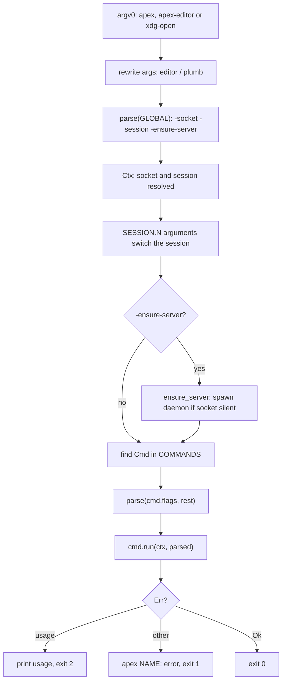
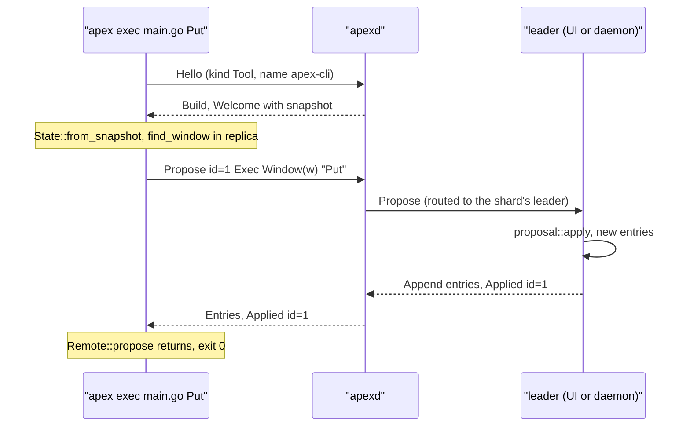

# The apex Command

`apex` (the `apex-cli` crate) is the stable public surface of apex for scripts, shells and people. Scripts and tools never see the wire: they run `apex new`, `apex edit`, `apex exec` and so on, and the command speaks the [attach protocol](attach-protocol.md) for them. The same binary is also the daemon (`apex server`, see [The Daemon (apexd)](daemon.md)), the remote bridge (`apex attach -stdio`, see [Remote Hosts and Providers](remote-hosts.md)), the launcher of the bundled tools (`apex tool …`, see [Writing Tools](tool-sdk.md)), and, under other names, `$EDITOR` and `xdg-open` inside a session.

Almost all the subcommands that work on a session share one design. Each one attaches to the session as a tool, so it has its own follower replica of the session state. It reads what it needs from that replica and sends changes as [proposals](proposals.md) to whoever leads the shard: the UI if one is attached, otherwise the daemon. That is why `apex` works with no UI running, and why a UI that attaches later finds the result. A few commands do not attach at all: `label`, `awd` and `status` write escape sequences to the terminal they run in, `md`, `shell-integration` and `version` only print, and `ls`, `stop` and the session commands use one-shot frames (see below). Profiles, `apex env` and `apex set` are covered in more depth on [Configuration](configuration.md).

## Architecture: one binary, a table of commands

The whole command lives in one file, `crates/apex-cli/src/main.rs`. It has four parts:

1. A small Go-style flag parser (`Flag`, `Parsed`, `parse`).
2. A static table `COMMANDS: &[Cmd]`. Each entry holds the command's name, its usage line, a one-line summary, its flags, its long help text and a `run: fn(&Ctx, &Parsed) -> R`. A second table, `TOPICS`, holds the help topics (`sessions`, `scripts`, `rules`, `windows`).
3. `main`, which resolves the socket and the session into a `Ctx`, finds the `Cmd` and calls it.
4. One function per subcommand. Most of them start with `tool(ctx)` and use `apex_server::remote::Remote`.

```rust
struct Cmd {
    name: &'static str,
    usage: &'static str,
    short: &'static str,
    flags: &'static [Flag],
    long: &'static str,
    run: fn(&Ctx, &Parsed) -> R,
}

struct Ctx {
    socket: PathBuf,
    session: String,
}
```

All help is generated from these tables. `apex` or `apex help` prints the overview (`overview`). `apex help CMD` prints the usage, the flags and the long text, and for `plumb` it also prints `RULE_FLAGS`. `apex help TOPIC` prints a topic. `apex CMD -h` prints only the usage and flags (`usage`). Because the long texts are the reference documentation, any change to a command's behaviour should update its `long` string as well.



Sources: [crates/apex-cli/src/main.rs:1-24](crates/apex-cli/src/main.rs#L1-L24), [crates/apex-cli/src/main.rs:105-148](crates/apex-cli/src/main.rs#L105-L148), [crates/apex-cli/src/main.rs:754-895](crates/apex-cli/src/main.rs#L754-L895), [crates/apex-cli/README.md:1-46](crates/apex-cli/README.md#L1-L46)

## Flags, the socket and the session

### Go-style flags

`parse` follows Go's `flag` package. Flags come before the arguments. The first argument that does not start with `-` (or is `-` alone) ends the flags, and so does `--`. A flag can be written `-name=value` or as `-name value`, where the value is the next argument. A boolean flag (`switch`) is written `-name`, or `-name=true`/`-name=false`, and `false` leaves it unset. Any number of leading dashes is accepted. `-h` and `-help` return the sentinel error `"help"`, which `main` turns into the usage. An unknown flag gives `flag provided but not defined: -NAME`, as Go does. `flag_tests` checks both value forms, checks that a switch never takes the next argument, and that a value flag with nothing after it is an error.

Parsing happens in two stages. Global flags are parsed first, up to the command name. The command's own flags are parsed after it. A few subcommands parse a third time after a verb: `win list -json`, `text read -addr=…` and `plumb rule add …` each call `parse` again on the arguments after the verb.

### Global flags and environment

| Flag | Default chain | Meaning |
|---|---|---|
| `-socket=PATH` | `$APEX_SOCKET`, else `daemon::default_socket`: `$TMPDIR/apex-$USER/main.sock` | the daemon's Unix socket |
| `-session=NAME` | `$apexsession`, then `$APEX_SESSION`, else `default` | session by id, an id prefix of four or more characters, or label |
| `-ensure-server` | off | start a daemon first if nothing answers on the socket |

`default_socket` (in the daemon module, imported by the CLI) uses `$TMPDIR`, or `/tmp`, and takes the user from `$USER`, then `$LOGNAME`, then the numeric uid, because a container's `exec` often sets neither. It also honours `$APEX_SOCKET` itself.

The daemon puts `apexsession` (the session's id), `apexsessionlabel` and `APEX_SOCKET` into the environment of every command and terminal in a session. As a result, `apex` run inside an apex terminal works on the session it is in without any flags.

Some arguments name a window in a particular session, as `SESSION.N`, for example `3f2a.12`. `main` handles these specially. Unless the command is one that takes such names itself (`B`, `plumb`, `switch`, `attach`, `new-session`, `end-session`, `rename-session`, `ls`, `editor`), any argument after the command name that `apex_server::global_window` recognises switches `ctx.session` to that session and is replaced by the bare window id. `global_window` also accepts a trailing `:LINE`, but only a session part made of hex digits and dashes, at least four characters long. That is how `apex text read 3f2a.12` reads window 12 of another session.

### Exit status

A command returns `R = Result<(), String>`. The error `"usage"` prints the usage and exits with status 2, and so do bad flags and unknown commands. Any other error is printed as `apex NAME: error` and exits with status 1. `apex CMD -h` prints the usage and exits 0.

Sources: [crates/apex-cli/src/main.rs:26-103](crates/apex-cli/src/main.rs#L26-L103), [crates/apex-cli/src/main.rs:121-125](crates/apex-cli/src/main.rs#L121-L125), [crates/apex-cli/src/main.rs:771-831](crates/apex-cli/src/main.rs#L771-L831), [crates/apex-cli/src/main.rs:2180-2204](crates/apex-cli/src/main.rs#L2180-L2204), [crates/apex-server/src/daemon.rs:64-79](crates/apex-server/src/daemon.rs#L64-L79), [crates/apex-server/src/daemon.rs:357-369](crates/apex-server/src/daemon.rs#L357-L369), [crates/apex-server/src/lib.rs:1747-1761](crates/apex-server/src/lib.rs#L1747-L1761)

## Every subcommand is a tool

`tool(ctx)` is the common entry point:

```rust
fn tool(ctx: &Ctx) -> Result<Remote, String> {
    Remote::connect_as(&ctx.socket, &ctx.session, "apex-cli", AttachmentKind::Tool)
        .map_err(|e| format!("{}: {e}", ctx.socket.display()))
}
```

A `Remote` (in `apex-server/src/remote.rs`) is a headless client: a `Link` plus its own mirror `Log` and `Node`. `Link::over_streams_inner` sends `Hello` and checks the daemon's `Build` message with `check_build`, so a daemon on a different `PROTOCOL` is refused with an error saying to `apex stop` it. It then waits for `Welcome`, builds `State::from_snapshot`, and catches the node up. Once that is done, the command can read the whole session synchronously from `c.node.state`: windows, layout, buffers, terms, `meta.procs`, `meta.rules` and `meta.settings`. A spawned reader thread delivers the messages that keep the replica current, and `Remote::step` handles one of them, blocking for up to the given timeout.

The CLI changes the session in two ways:

- **Proposals.** `Remote::propose(p, timeout)` sends `ClientMsg::Propose { id, proposal }` and then calls `step` until `link.applied` holds that id. The leader applies the proposal with `proposal::apply` and replies `Applied { id, result }`. The result can carry a `WindowId` for proposals that make a window. `new`, `win` (including `win status`, which proposes `SetStatus`), `edit`, `sel`, `show`, `exec`, `term new`, `web`, `switch`, `preview` and `editor`'s labelling work this way.
- **Direct requests the daemon serves itself.** `OpenFile`, `Plumb`, `RuleAdd`/`RuleRm`, `Cd`, `Set`, `Env`/`EnvImport`, `Kill`, `Notify`, `EditOver`, `TermPaste`/`TermKey`/`TermClear` and `Io` are plain `ClientMsg`s. For these the command waits until the effect shows up in its replica or in a `Link` field: `link.plumbed`, `link.trace`, `link.rule_added`, `link.env`, `link.error` or `link.io`.

`wait(r, done)` in main.rs is the CLI's generic loop for the second case. It steps the `Remote` in 20 ms slices until a predicate on the replica holds, or until `TIMEOUT` (10 s) has passed. `Remote` has its own equivalent, `wait_for`, for its typed helpers (`rule_add`, `plumb_dry`, `env`, `io_response`, …).



When the process exits, the `Link` is dropped, its transport closes, and the daemon sees the attachment go. Anything the command owned goes with it, for example a rule added with `-mine`.

Sources: [crates/apex-cli/src/main.rs:897-918](crates/apex-cli/src/main.rs#L897-L918), [crates/apex-server/src/remote.rs:1-5](crates/apex-server/src/remote.rs#L1-L5), [crates/apex-server/src/remote.rs:207-265](crates/apex-server/src/remote.rs#L207-L265), [crates/apex-server/src/remote.rs:307-312](crates/apex-server/src/remote.rs#L307-L312), [crates/apex-server/src/remote.rs:341-454](crates/apex-server/src/remote.rs#L341-L454), [crates/apex-server/src/remote.rs:571-583](crates/apex-server/src/remote.rs#L571-L583), [crates/apex-server/src/remote.rs:723-788](crates/apex-server/src/remote.rs#L723-L788), [crates/apex-server/src/remote.rs:1046](crates/apex-server/src/remote.rs#L1046)

## Naming windows: `find_window`

Wherever a command takes `WIN`, it goes through `find_window(c, spec)`, which resolves against the replica in this order:

1. A number is a window id. It must exist.
2. `SESSION.N` is window N, but only if `SESSION` is this session's id, a prefix of it (four or more characters) or its label. Otherwise the error says to use `-session=`.
3. An exact path. If several windows have that path, the one plain non-scratch `File` window wins, so `notes.md` means the file rather than its preview.
4. An exact label, if exactly one window has it.
5. A kind name such as `errors`, if exactly one window has that kind.
6. A unique substring of a path or label. Zero hits gives `no window matches "…"`, several gives `N windows match "…"`.

Relative paths given by the user are made absolute against the CLI's current directory with `absolute`, which keeps a trailing `/`. Exactly where a command does this is noted in the subcommand sections below.

Sources: [crates/apex-cli/src/main.rs:1273-1334](crates/apex-cli/src/main.rs#L1273-L1334)

## The subcommands

### Daemon and sessions

| Command | What it does | How |
|---|---|---|
| `server` | runs the daemon in the foreground with one first session | `Daemon::run(socket, session)` |
| `ls` | `label<TAB>id` for each session | `remote::list_sessions`, no attach |
| `stop` | ends the daemon and every session in it | `remote::stop_any` |
| `new-session NAME [DIR]` | makes a session (it is fine if it already exists) and prints its id | `valid_label`, checks that DIR is a directory, `ensure_server`, `remote::new_session` |
| `end-session [-f] [NAME]` | ends a session; refused if a window is dirty, unless `-f` | `remote::end_session` |
| `rename-session [FROM] TO` | relabels a session | `remote::rename_session` |
| `attach [-stdio] [[DEST/]SESSION \| URL] [FILE...]` | opens the app, or bridges stdio | see below |
| `version` | prints `apex build ID protocol N` | `BUILD_ID`, `proto::PROTOCOL` |
| `shell-integration zsh\|bash` | prints hooks that emit OSC 133 prompt marks and OSC 7, active only when `TERM_PROGRAM=apex` | `ZSH_INTEGRATION`, `BASH_INTEGRATION` |

The session commands use one-shot helpers in `remote.rs` that write a single frame and read until they get `Sessions` or `Error`, without attaching. Every one of those helpers checks `Build` as well.

`stop_any` deliberately does not depend on the protocol version. If `list_sessions` fails with `Unsupported`, meaning the daemon is of another protocol, it gets the socket peer's pid (`LOCAL_PEERPID` on macOS, `SO_PEERCRED` elsewhere). It then checks with `ps` that the process's command line contains `apex`, ` server` and this very socket path, sends SIGTERM, and sends SIGKILL if the process is still alive after 3 s. This is how a daemon from an old build is cleared away.

`ensure_server` starts a daemon if `UnixStream::connect` fails. The daemon's first session is the requested name if that is a valid label, otherwise `default`, since an id cannot name a session on a fresh daemon. `daemon::spawn_server` re-executes the same binary as `apex -socket=… -session=… server` from `$HOME`, with no stdin or stdout, in a session of its own (`setsid`, so an ending ssh session or a bridge's process group does not take it along) and with signal dispositions reset to their defaults, so that an ignored SIGTERM inherited from the app does not stick. Its stderr goes to `apexd.log` beside the socket (`daemon_log`). It waits up to 5 s for the socket to answer.

`attach` first decides what it is attaching to. If the first argument does not exist as a path, it is the target, otherwise the target is the current session. A session URL (`local:///`, `ssh://…`, `sprite://…`, parsed by `providers::SessionUrl`) is reduced to a session name or to `dest/session`. With `-stdio`, it calls `ensure_server` and then `bridge`, which copies bytes between the socket and stdin/stdout on two threads until either side closes. Frames pass through untouched, and this is the whole server side of [remote hosts](remote-hosts.md). Without `-stdio`, it runs `apex-ui` (found beside the `apex` binary) as `--remote DEST --session S` or `--attach SOCKET --session S`, passing on the FILE arguments.

Sources: [crates/apex-cli/src/main.rs:922-1002](crates/apex-cli/src/main.rs#L922-L1002), [crates/apex-cli/src/main.rs:1091-1094](crates/apex-cli/src/main.rs#L1091-L1094), [crates/apex-cli/src/main.rs:1161-1269](crates/apex-cli/src/main.rs#L1161-L1269), [crates/apex-server/src/remote.rs:509-522](crates/apex-server/src/remote.rs#L509-L522), [crates/apex-server/src/remote.rs:586-720](crates/apex-server/src/remote.rs#L586-L720), [crates/apex-server/src/daemon.rs:25-62](crates/apex-server/src/daemon.rs#L25-L62), [crates/apex-server/src/daemon.rs:1601-1604](crates/apex-server/src/daemon.rs#L1601-L1604)

### Windows and text

| Command | Behaviour | Mechanism |
|---|---|---|
| `new [-diagnostic] [-label=L] [PATH]` | makes a window and prints its id; if stdin is not a terminal, its contents go in | `Exec Top "New"`, waits for the new window, `ReplaceRange` at 0, `SetPath` to PATH made absolute. With `-diagnostic`: `NewWindow { scratch: true, diagnostic: true }` in the last column, named PATH (absolute) or the current directory, with stdin's text written into it too; `-label` is only allowed with `-diagnostic` |
| `open FILE...` | opens files in the first column; prints `id<TAB>path` | `ClientMsg::OpenFile` per file, then waits for the window count to rise. A file that is already open adds no window |
| `win list [-json]` | `id kind marks path label status`, column by column, including stashed windows | reads the layout with `tiling::stash_order`. Marks are `*` dirty, `>` live, `+` scratch, `-` none. Dirty is suppressed for scratch and live windows. The status column is the window's state and its message. `-json` adds `status` (`state`, `kind`, `progress`, `msg`, or null) and `scratch`, `live` and `dirty` as booleans |
| `win del\|rename\|label\|status\|tag` | Del as acme does it (warns once if dirty), move to another path, set label, set or clear the window's status, read or replace the tag's user text | `Exec Window "Del"`, `SetPath`, `SetLabel`, `SetStatus`, `ReplaceRange` on the tag buffer |
| `text read [-addr=ADDR] WIN` | prints the body, or only what an address selects | reads the replica. `-addr` runs `apex_edit::Edit` locally with the program `ADDRp` from the window's selection |
| `edit WIN PROGRAM` | runs an [Edit](edit-language.md) program | `Proposal::Edit` |
| `sel WIN [Q0 Q1]` | reads or sets the body selection | replica, or `Proposal::Select` |
| `show WIN [Q \| :LINE]` | scrolls a place into view without moving dot | `Proposal::Show` |
| `exec [WIN] COMMAND` | runs text as B2 would, in a window's context or the top row's | `Proposal::Exec` |
| `events [-shard=S]` | streams every appended entry as JSON (`shard`, `seq`, `attachment`, `epoch`, `op`) | reads `link.rx` directly and prints `Entries` before handling them |

`win status WIN STATE [kind=K] [progress=N] [MSG]` proposes `Proposal::SetStatus` with a `WindowStatus` whose `by` is `SERVER` (the session's own word), so it stands after the command has gone, until `win status WIN clear` removes it. The arguments are parsed by `status_args`, shared with `apex status` (see below).

`text read -addr` is notable because it never touches the daemon. The address is evaluated on the CLI's own replica by the same `apex-edit` code the node uses, and the result is taken from the `p` command's output (`outcome.output_string()`).

`events` is acme's event file generalised. It prints the entries as they arrive and passes each message on to `c.handle`, so the replica keeps up. `-shard` keeps only shards whose name starts with the given text. It runs until the connection ends or stdout closes.

Sources: [crates/apex-cli/src/main.rs:219-288](crates/apex-cli/src/main.rs#L219-L288), [crates/apex-cli/src/main.rs:1343-1610](crates/apex-cli/src/main.rs#L1343-L1610), [crates/apex-cli/src/main.rs:1939-1959](crates/apex-cli/src/main.rs#L1939-L1959)

### Terminals, processes and program status

| Command | Behaviour |
|---|---|
| `term new [CMD...]` | proposes `Exec Top "Newterm CMD…"`, waits for a new `TermId` in `state.terms` and prints it |
| `term send TERM TEXT` | sends `TermPaste` with the text. A trailing `\n` or `\r` is stripped and sent as a `TermKey` `enter` instead, because shells with bracketed paste take a pasted newline literally |
| `term read TERM` | prints the replicated grid (`state.terms[t].grid`), each row trimmed on the right |
| `term clear TERM` | `TermClear`, which drops the scrollback |
| `ps [-a]` | lists `meta.procs`: pid, name, origin (window id, `col N` or `top`), start time, directory and command. With `-a` it includes the recently ended ones and how each ended |
| `kill NAME\|PID...` | checks every target against the running records, sends `ClientMsg::Kill`, waits up to 2 s for those records to stop running, then prints what is still running |
| `cd [DIR]` | prints or changes `meta.cwd`. The path is normalised as a shell would, with a trailing `/`. Sends `ClientMsg::Cd` and waits for the replica to show it, or for `link.error` |
| `label TEXT`, `awd [LABEL]` | write escape sequences to `/dev/tty` (stdout if that fails): `ESC ] ; text BEL` for the label, and for awd an OSC 7 `file://host/pwd` followed by the label (the host name by default) |
| `status [-id=ID] STATE [kind=K] [progress=N] [MSG]` / `status clear` | writes an OSC 7501 report to the terminal it runs in, as a program speaking the Program Status Protocol would |

A terminal's TERM argument may be a terminal id or anything `find_window` accepts that names a `Body::Term` window. `label`, `awd` and `status` neither attach nor talk to the daemon. They speak to the terminal they run in, and the [terminal](terminals.md) loop turns the sequences into the window's `DIR/-TITLE` name or, for OSC 7501, into its status.

`apex status` is the shell-side way to use [the Program Status Protocol](program-status.md). `STATE` is one of `idle`, `working`, `done`, `blocked`, `error`, or `clear`. After it come optional `kind=K` (`permission`, `question`, `auth`) and `progress=N` (0 to 100) words, and the rest of the arguments joined by spaces are the message. `-id` names the record, for one part of the work (`build`, `test`); without it the report is the whole. `clear` removes the record with that id, or every record when no `-id` is given. Bad states, kinds and percentages are errors, and the state is not optional (`status_tests`). Per the command's own help, working and blocked end at the shell's next prompt, while idle and done stand until cleared.

The names `ps` and `kill` show are the programs' own: a tool such as `apex tool lsp`, started by the server as `apex tool lsp`, announces itself with `ClientMsg::Named`, so it shows as `lsp` and not `apex`. `programs_say_what_they_are_called` in the tests checks this, including that a connected program of no known group is adopted for as long as it stays connected.

Sources: [crates/apex-cli/src/main.rs:597-631](crates/apex-cli/src/main.rs#L597-L631), [crates/apex-cli/src/main.rs:1007-1089](crates/apex-cli/src/main.rs#L1007-L1089), [crates/apex-cli/src/main.rs:1612-1674](crates/apex-cli/src/main.rs#L1612-L1674), [crates/apex-cli/src/main.rs:1909-1980](crates/apex-cli/src/main.rs#L1909-L1980), [crates/apex-cli/src/main.rs:2159-2178](crates/apex-cli/src/main.rs#L2159-L2178), [crates/apex-cli/tests/cli.rs:494-549](crates/apex-cli/tests/cli.rs#L494-L549)

### Plumbing, B and editing in place

`plumb TEXT` sends `ClientMsg::Plumb` from the CLI's current directory, in the top-row context or, with `-win`, from a window. It waits for `link.plumbed`. If no rule took the text, the command exits non-zero with the reason, as Plan 9's `plumb` does, even though the session then falls back to Look. `-dry-run` uses `Remote::plumb_dry` and prints the trace instead. `-edit` sets `edit_only`, which tries only the rules that open in the session.

`plumb rule add|rm|ls` manages the [rule table](plumbing.md):

- `rule_of` turns `RULE_FLAGS` into a `PlumbRule`. There must be exactly one action among `-edit`, `-run`, `-tool` and `-client` (with `-args` for the client verb). The predicates are `-text`, `-file`, `-owner`, `-win`, `-kind`, `-isfile` and `-isdir`. `-verb` names the command the rule answers and defaults to `plumb` (B3); any other word is offered in the tools menu, and `-unlisted` keeps it out of that menu while B2 still runs it. `-start` gives the command that starts a `-tool` rule's tool when none is attached. `-to` (`errors` or `window`) says where a `-run` command's output goes. `-kind` is parsed with `WinKind::parse` and `-to` is validated, priority defaults to 0, and the rule's own `check()` runs last. `Remote::rule_add` then prints the new id; `-mine` makes the rule belong to this attachment and go with it, rather than to the session.
- `rm` accepts ids with or without the `r` prefix and removes session rules.
- `ls` prints the table in the order it is tried (`plumb::ordered`), showing id, owner, priority and the rule as flags (`to_flags`). The owner is `session`, or `name(attachment)`.

`B FILE[:LINE]...` sends an `edit_only` plumb for each argument and waits for a window to appear. `switch SESSION [WIN]` proposes `Proposal::Switch` to the window showing this session.

`editor FILE` is plan9port's editinacme:

1. It makes the path absolute and prints `editor: editing FILE` on stderr.
2. If `$winid` names a window, it sends `EditOver { under, name }` and waits for a window on the file stacked over that one. Otherwise it plumbs the path `edit_only` and waits for a `File` window with that path.
3. It labels the window `$EDITOR for PROG` (via `apex_server::waiting_program`, the first non-shell ancestor process, found with `ps` over at most six levels) or just `$EDITOR`, and steps until the window is gone.
4. On interrupt (`catch_interrupts`/`INTERRUPTED`), it restores the old label and fails.

`notify [-win=WIN]` sends `Notify` for that window (default `$winid`) and returns once `window_notified` goes false again.

Sources: [crates/apex-cli/src/main.rs:127-146](crates/apex-cli/src/main.rs#L127-L146), [crates/apex-cli/src/main.rs:1676-1811](crates/apex-cli/src/main.rs#L1676-L1811), [crates/apex-cli/src/main.rs:1813-1907](crates/apex-cli/src/main.rs#L1813-L1907), [crates/apex-server/src/lib.rs:1900-1927](crates/apex-server/src/lib.rs#L1900-L1927), [crates/apex-server/src/remote.rs:791-802](crates/apex-server/src/remote.rs#L791-L802)

### Environment, settings, I/O, pages and tools

| Command | Behaviour |
|---|---|
| `env [-import] [KEY=VALUE...]` | sets session variables, or prints them all when given none. `-import` sends this process's whole environment as `EnvImport`, so the differences become the session's (the profile's exit hook uses this) |
| `set [KEY VALUE]` | sends `ClientMsg::Set`. If `$apexattachment` is set (inside an attach script), the setting belongs to that attachment. With no arguments it prints `owner key value` from `meta.settings` |
| `cat PATH` | `Remote::read_file`, a `GET file://PATH` on the [I/O plane](io-plane-and-pages.md) |
| `io [-watch] METHOD URL` | one request on the plane. A body is read from stdin for PUT, and for other non-GET/HEAD/DELETE/OPTIONS methods when stdin is not a terminal. A non-200 status prints the body and exits 1. `-watch` sends a `Watch: 1` header and prints each file version as it arrives. `CONNECT` becomes an nc-style tunnel, with a thread feeding stdin while the main loop prints the frames that come back |
| `web open URL` / `web [-label L] <HTML` | `Proposal::open_url` or `open_html` in the first column, then prints the new window's id |
| `preview FILE` | proposes `Exec Top "apex tool preview FILE"`, so the converter runs on the host as one of the session's commands |
| `diff [-C DIR] [FILE]` | reads a unified diff from FILE or stdin and calls `apex_tool::Tool::attach_to(..., "diff").diff(...)` |
| `md` | Markdown on stdin to an HTML page on stdout (`apex_tool_preview::markdown::markdown_page`); it never attaches |
| `tool win\|lsp\|preview\|web\|agent\|bridge` | calls each tool crate's `run` in-process: `apex_tool_win`, `apex_tool_lsp`, `apex_tool_preview` (with a FILE, or `run_resident` as the resident tool), `apex_tool_web`, `apex_tool_agent::cmd`, `apex_tool_bridge` |

The tools are covered on [win and Language Servers](tool-win-and-lsp.md), [Preview, Web and Diff Tools](tool-pages.md), [Coding Agents](agent-tools.md) and [JSON Bridge and Go SDK](bridge-and-go.md). The CLI's only job for them is to pick the socket and session and call `run`. The agent tool's own help now describes the terminal status it sets for a coding agent, and says an agent that reports its own status over OSC 7501 gets its status from that and none from the tool.

Sources: [crates/apex-cli/src/main.rs:458-596](crates/apex-cli/src/main.rs#L458-L596), [crates/apex-cli/src/main.rs:1096-1159](crates/apex-cli/src/main.rs#L1096-L1159), [crates/apex-cli/src/main.rs:1984-2156](crates/apex-cli/src/main.rs#L1984-L2156), [crates/apex-server/src/remote.rs:804-1031](crates/apex-server/src/remote.rs#L804-L1031)

## apex-editor and xdg-open

`main` looks at the name the binary was run as before it parses anything:

- As `apex-editor`, it inserts `editor`, so `apex-editor FILE` behaves as `apex editor FILE`.
- As `xdg-open`, it requires exactly one argument that is not a flag and inserts `plumb`. Any program that opens a URL or a file that way (`gh`, `cargo doc --open`) gets it plumbed into the session, as B3 would.

The daemon creates these links. For every new session, `editor_command` and `link_beside` make a symlink of that name beside a binary named `apex`, if it is missing and the directory allows it. The session environment then gets `EDITOR` (the link, or `PATH/apex editor` as a two-word fallback) and `BROWSER` (the `xdg-open` link). Since the binary's directory leads the session's `PATH`, `xdg-open` there is apex's own. The link has to be one word because zsh and rc do not split `$EDITOR`. The test binary is not named `apex`, so tests see the fallback.

Sources: [crates/apex-cli/src/main.rs:754-770](crates/apex-cli/src/main.rs#L754-L770), [crates/apex-server/src/daemon.rs:357-369](crates/apex-server/src/daemon.rs#L357-L369), [crates/apex-server/src/daemon.rs:1606-1634](crates/apex-server/src/daemon.rs#L1606-L1634), [crates/apex-cli/tests/cli.rs:551-684](crates/apex-cli/tests/cli.rs#L551-L684)

## Error handling and timing

Most waits are bounded by `TIMEOUT` (10 s). `Remote::propose` reports `timed out waiting for the leader`, `wait` reports `timed out`, and a closed connection gives `connection closed`. A few commands do not wait for an acknowledgement. `term send`, `term clear`, `set` and `rule rm` send their message and give the daemon 50 ms (`c.step`) before the process exits and the link closes. Code that needs certainty should check the result afterwards, for example with `apex set` alone.

`open` and `B` ignore their wait's timeout, because opening an already-open file adds no window. Errors the daemon sends (`ServerMsg::Error`) are printed by the link as `remote: server: …` and stored in `link.error`. `cd` is the command that turns that field into its own failure.

Sources: [crates/apex-cli/src/main.rs:22](crates/apex-cli/src/main.rs#L22), [crates/apex-cli/src/main.rs:902-918](crates/apex-cli/src/main.rs#L902-L918), [crates/apex-cli/src/main.rs:1064-1089](crates/apex-cli/src/main.rs#L1064-L1089), [crates/apex-cli/src/main.rs:1395-1417](crates/apex-cli/src/main.rs#L1395-L1417), [crates/apex-cli/src/main.rs:1638-1671](crates/apex-cli/src/main.rs#L1638-L1671), [crates/apex-cli/src/main.rs:1721-1733](crates/apex-cli/src/main.rs#L1721-L1733), [crates/apex-server/src/remote.rs:455-458](crates/apex-server/src/remote.rs#L455-L458), [crates/apex-server/src/remote.rs:748-788](crates/apex-server/src/remote.rs#L748-L788)

## Tests

`crates/apex-cli/tests/cli.rs` drives the real binary (`CARGO_BIN_EXE_apex`) against a `Daemon::run_with` on a thread. Each test has its own socket in the temp directory and a session named `main`. The helpers `apex`, `ok` and `labels` run one command and capture its output.

- `scripts_drive_a_headless_session` is the core end-to-end check with no UI. It runs open, list, read, read with `-addr`, an Edit, Put through `exec`, `sel`, a `|sort` pipe, a terminal round trip (`term new`/`send`/`read`), session isolation, and Del's warn-once behaviour.
- `attach_stdio_bridges_the_socket` attaches a `Link` over `apex attach -stdio`'s pipes.
- Other tests cover sessions, their ids and ending, profiles and attach scripts, rules, their owners and tool refusal and start (`a_rule_starts_its_tool_when_none_is_attached`), `ps`/`kill` and the names programs announce, `editor` (plain, over a terminal, from any window, interrupted), `io` tunnels, fetches and watches, preview, `env -import`, `notify`, `cd`, the JSON bridge, and `md`.

Two unit-test modules live in main.rs itself: `status_tests` (the grammar of `status_args`) and `flag_tests` (the flag parser). The integration tests do not exercise `apex status` or `win status`.

`tests/ssh.rs` fakes `ssh` with a script and checks the remote install-and-bridge path.

Sources: [crates/apex-cli/tests/cli.rs:1-182](crates/apex-cli/tests/cli.rs#L1-L182), [crates/apex-cli/tests/cli.rs:966-992](crates/apex-cli/tests/cli.rs#L966-L992), [crates/apex-cli/tests/cli.rs:1176-1222](crates/apex-cli/tests/cli.rs#L1176-L1222), [crates/apex-cli/src/main.rs:2159-2204](crates/apex-cli/src/main.rs#L2159-L2204), [crates/apex-cli/tests/ssh.rs:1-36](crates/apex-cli/tests/ssh.rs#L1-L36)
