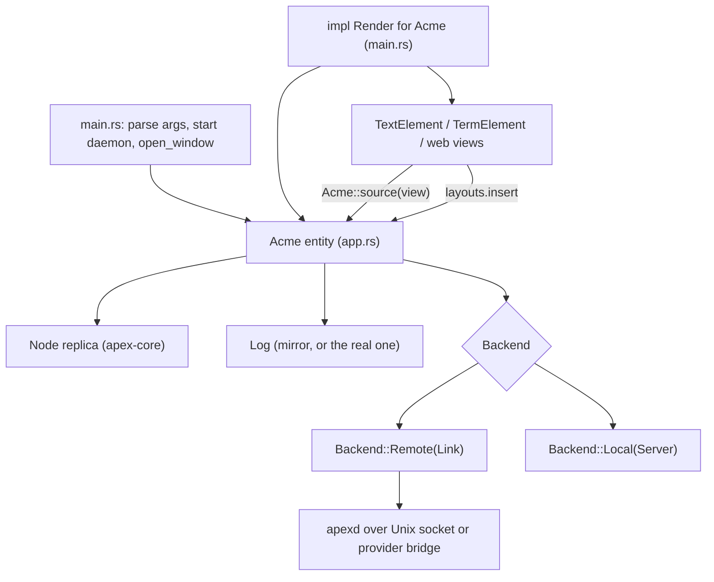
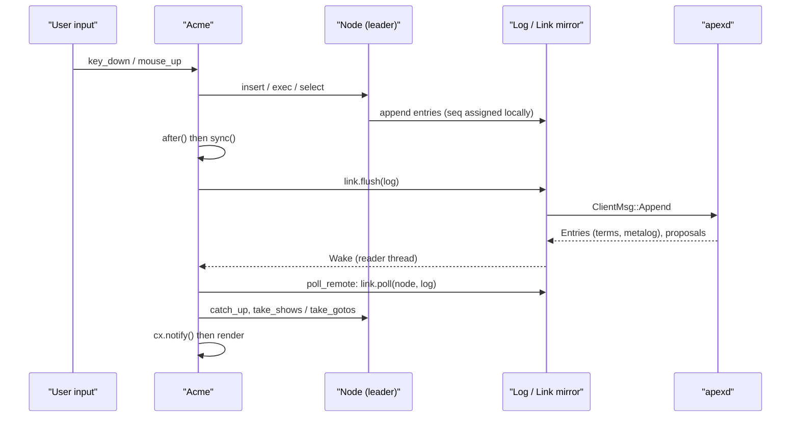
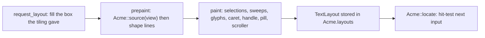

# The UI Client (apex-ui)

`apex-ui` is apex's graphical client. It is a [gpui](https://github.com/zed-industries/zed) application in the `apex-client` crate, and the app bundle runs it. It draws a session's state the way acme draws its screen: columns, windows, tags, bodies, terminals and pages. It turns the mouse and keyboard into log entries. The client is not a thin view. It runs a full `Node` replica and, once it attaches, it takes the leases and becomes the **leader** of the buffer, window and layout shards (see [Sessions, Shards and Leadership](sessions-and-replication.md)). Every edit the user makes is sequenced in the client and shipped to the daemon, not the other way round.

This page covers how the client is put together: the command line and launch in `main.rs`, the `Acme` entity in `app.rs`, the `Backend` that puts the server either behind a socket or in-process, the sync/render loop, and the `TextElement` that paints text straight from core state. Other pages cover the rest: [Mouse, Keyboard and Look](client-input.md) for input, [Pickers and Overlays](client-overlays.md) for overlays, [Sessions, Tabs and Window Chrome](client-chrome.md) for tabs, the sidebar and the title bar, and [Themes, Fonts and Colour](themes-and-fonts.md) for themes. Terminal painting is on [Terminals](terminals.md) and web views are on [The I/O Plane and Pages](io-plane-and-pages.md).

## Architecture at a glance

The crate builds one binary, `apex-ui` (`[[bin]] name = "apex-ui"`). It depends on `apex-core` for state, `Node` and tiling, `apex-server` for `Server`, `Link`, the protocol and providers, and `apex-edit`. It also pulls in gpui from Zed's tree (`main` branch, with `runtime_shaders` and `font-kit`), `core-text`, `objc` and `block2` for macOS, and `wry` for native web views. On aarch64 it pins `pathfinder_simd` with `pf-no-simd`. `main.rs` declares about three dozen modules ([main.rs:14-49](crates/apex-client/src/main.rs#L14-L49)). Most of them add to the one `Acme` type with further `impl Acme` blocks.

| Module | Role |
|---|---|
| `main.rs` | Command line, app startup, `open_window`, and `impl Render for Acme`, which builds every frame's element tree (about 1,400 lines) |
| `app.rs` | `Acme`, the per-window entity: `Log` + `Node` + `Backend`, input handlers, sync, measurement, execute and look (about 5,800 lines) |
| `shell.rs` | The app shell: menus and key bindings, theme/font/palette setters, login-shell environment, which sessions to reopen, starting the daemon, installing the `apex` command, and the session selector with its known hosts and recent sessions |
| `pool.rs` | Tabs (`TabId`) and parked sessions: links kept attached while not shown |
| `text_element.rs` | `TextElement`, a custom gpui `Element` that shapes and paints a tag, top row or body from core state, and `TextLayout` for hit-testing. Also the tag head, a window status's pill and its icons, and the scrollbar and handle painters |
| `term_element.rs` | `TermElement`, the terminal grid painter ([Terminals](terminals.md)) |
| `web.rs`, `webbar.rs`, `outline.rs` | Native WKWebView placement, page headers, and the page outline drawn as ticks in a page's scrollbar ([I/O plane](io-plane-and-pages.md)) |
| `menu.rs`, `look.rs`, `warp.rs`, `cursor.rs` | B4 menu, live Look, pointer warps, cursor styles ([input](client-input.md)) |
| `finder.rs`, `quickopen.rs`, `commands.rs`, `completion.rs`, `tagedit.rs`, `cwdbar.rs`, `field.rs` | Pickers and overlays ([overlays](client-overlays.md)) |
| `sidebar.rs`, `titlebar.rs`, `titlefit.rs`, `switcher.rs`, `miniature.rs`, `shelf.rs`, `strips.rs`, `glide.rs`, `toasts.rs`, `attention.rs`, `procs.rs`, `standing.rs`, `restart.rs` | Chrome around the tiled windows ([chrome](client-chrome.md)) |
| `bunny.rs` | The small drawing shown in an empty column |
| `theme.rs`, `fonts.rs`, `contrast.rs` | Palettes, font sets, terminal contrast ([themes](themes-and-fonts.md)) |



Sources: [crates/apex-client/Cargo.toml:1-30](crates/apex-client/Cargo.toml#L1-L30), [crates/apex-client/src/main.rs:14-49](crates/apex-client/src/main.rs#L14-L49), [crates/apex-client/src/app.rs:382-392](crates/apex-client/src/app.rs#L382-L392), [crates/apex-client/README.md:1-23](crates/apex-client/README.md#L1-L23)

## The command line and launch

`main()` parses its arguments by hand ([main.rs:704-730](crates/apex-client/src/main.rs#L704-L730)) into a `Target` ([main.rs:690-702](crates/apex-client/src/main.rs#L690-L702)), which says where the window's session lives:

| Flag | Effect | `Target` |
|---|---|---|
| *(none)* `[files]` | Attach to the local daemon, starting it if needed. Reopen the last session, else the first existing one, else make `default` | `Url` (from `shell::plan`) |
| `--session S` | That local session | `Url { SessionUrl::local(S) }` |
| `--attach [SOCKET]` | Another daemon socket. A following argument is taken only if it ends in `.sock`, else the default socket is used. Sets `APEX_SOCKET` | (affects socket) |
| `--via CMD` | Speak the protocol over CMD's stdin/stdout | `Via` |
| `--remote DEST` / `--ssh DEST` | A destination through its provider (`user@host`, `provider:name`), via `Dest::parse` | `Url` with provider |
| `--url URL` | A session URL, parsed by `SessionUrl::parse`. A bad one exits with status 2 | `Url` |
| `--local` | Run the `Server` in this process | `Local` |
| `-psn_…` | Ignored (Finder passes it) | — |

A fourth variant, `Target::Choose(why)`, is used when nothing should be reopened: macOS asked not to (`ApplePersistenceIgnoreState`), or the previous launch died before it "settled". `shell::reopen_refused` detects this through a `launching` marker file next to the state file. The marker is written at launch and removed 15 seconds later or on quit ([shell.rs:465-499](crates/apex-client/src/shell.rs#L465-L499), [main.rs:816-825](crates/apex-client/src/main.rs#L816-L825)). The window then opens on no session with the session selector up. `--session` still wins over a refusal ([main.rs:857-859](crates/apex-client/src/main.rs#L857-L859)).

Before gpui starts, `shell::adopt_login_shell_environment` runs `$SHELL -l -i -c 'env -0 2>/dev/null || env'` and adopts the result, skipping `_`, `SHLVL`, `PWD`, `OLDPWD`, `TERM`, `TERM_PROGRAM` and `TERM_SESSION_ID`. An app launched from the Finder otherwise gets LaunchServices' bare `PATH`, and the daemon it starts would inherit that too ([shell.rs:322-351](crates/apex-client/src/shell.rs#L322-L351), [main.rs:736-740](crates/apex-client/src/main.rs#L736-L740)). Inside `application().run`, `main` installs the Dock icon, cursors, symbol font, font sets, the tab `Pool`, the theme, the menus, the app-level actions and the key bindings from `shell::bindings()`. The actions cover theme, palette, font set and size, contrast, caret blink, smooth caret, layout animations, sidebar, Quit and Install CLI ([main.rs:741-812](crates/apex-client/src/main.rs#L741-L812)). Then it picks the target:

- **Local daemon.** `shell::ensure_daemon` lists sessions on the socket. If nothing answers, it spawns `apex` from beside the executable or from `PATH` via `daemon::spawn_server`. A daemon of another build answers with `ErrorKind::Unsupported`. In that case the window still opens and offers a restart (`offer_restart`) instead of starting a second daemon over the first's socket ([shell.rs:529-556](crates/apex-client/src/shell.rs#L529-L556), [main.rs:844-856](crates/apex-client/src/main.rs#L844-L856)).
- **`shell::plan`** chooses the session. It takes the URL and frame remembered in `~/Library/Application Support/apex/last-sessions` (a session that has gone is made again on attach), else the first session the daemon lists, else it creates `default`. With an `Unsupported` daemon it returns the remembered window, or `default`, without listing anything ([shell.rs:501-527](crates/apex-client/src/shell.rs#L501-L527)).
- **Remote sessions** are attached only after the window is open. `open_window` makes an offline window that says it is attaching, and `Pool::start` builds the link in the background, because uploading a binary or starting a remote daemon can take a while ([main.rs:869-887](crates/apex-client/src/main.rs#L869-L887)).

apex has one OS window. Every other open session is a tab in it, restored by `Pool::restore` unless the launch is choosing. `shell::save_open` records the window's URL and frame (and full-screen) in the state file, skipping windows with no socket and `via` windows ([shell.rs:408-445](crates/apex-client/src/shell.rs#L408-L445)). Quitting saves the open windows, sets `QUITTING`, calls `close_link` on every window so bridges and daemons see the attachment leave, and closes the pool ([main.rs:779-797](crates/apex-client/src/main.rs#L779-L797)). Quitting from the Dock or by AppleScript does not run that action, so `on_app_quit` saves and clears the marker too ([main.rs:898-906](crates/apex-client/src/main.rs#L898-L906)). Closing the window, through the red button, `Exit` or `CloseWindow`, *parks* the session in the pool instead of detaching it.

Sources: [crates/apex-client/src/main.rs:690-915](crates/apex-client/src/main.rs#L690-L915), [crates/apex-client/src/shell.rs:322-556](crates/apex-client/src/shell.rs#L322-L556)

## Opening a window and driving it

`open_window` ([main.rs:919](crates/apex-client/src/main.rs#L919)) builds the gpui window with a transparent title bar and `app_owns_titlebar_drag`, since the title bar is apex's own. It then constructs the `Acme` entity according to the target. The client is woken in two different ways, depending on the backend:

- **In-process (`Target::Local`).** `Acme::new` returns an `UnboundedReceiver<ServerEvent>` along with the `Acme`. A spawned task feeds each event to `Acme::pump`, which hands it to `Server::pump`, performs the resulting proposals and syncs.
- **Over a link (`Url`, `Via`, `Choose`).** The `Link`'s reader thread calls a `Wake` closure, which sends `()` on a futures channel. A task on the UI thread waits on that channel and calls `poll_remote`. It then handles a pending session switch, tells the pool the tab is open and settled, settles the snarf buffer to the clipboard, honours `leave_requested`/`close_requested`, and calls `cx.notify()` to redraw ([main.rs:1005-1040](crates/apex-client/src/main.rs#L1005-L1040)).

`offline_window` ([main.rs:1106](crates/apex-client/src/main.rs#L1106)) makes an `Acme` over a blank in-process session pointed at a URL, with `connected = false` and a `waiting` message. It is used for remote targets before their link exists, for `Choose`, and when a local attach fails (which also stores `connect_error`'s text with `wait_failed`). A later Reconnect (⌘⇧R) or the picker attaches it for real. `open_window` also follows the system appearance for the System theme and saves the window's frame whenever its bounds change.

`Acme::over` ([app.rs:1698](crates/apex-client/src/app.rs#L1698)) is the shared constructor. Besides filling in the hundred-odd fields, it starts two timers:

- a **100 ms tick** that polls things gpui cannot report. A native web view keeps pointer moves to itself, so the tick asks the system for the pointer position, and it also checks modifiers for ending ctrl-tab. It drives the caret blink, strips, tabs, link retry (`link_tick`), toasts and the Dock (`attention::tick`), and notifies only when something changed;
- a **heartbeat** every 3 s. `heartbeat` ([app.rs:1667](crates/apex-client/src/app.rs#L1667)) sends `ClientMsg::Ping`. If a pong is more than 8 s overdue, the link is marked disconnected even though the socket has not closed (ssh gone quiet, for example). A pong arriving later marks it connected again and records `ping_ms`.

Sources: [crates/apex-client/src/main.rs:917-1130](crates/apex-client/src/main.rs#L917-L1130), [crates/apex-client/src/app.rs:1667-1780](crates/apex-client/src/app.rs#L1667-L1780)

## The `Acme` entity and the `Backend`

`Acme` is a gpui entity, one per OS window. Its core is three fields:

```rust
pub enum Backend {
    /// In this process, sharing the log.
    Local(Server),
    /// Behind a socket; the log is a mirror.
    Remote(Link),
}

pub struct Acme {
    pub log: Log,
    pub node: Node,
    pub backend: Backend,
    // ... about a hundred more fields of UI state
}
```

The module comment states the design: "Every change goes through the leader node as log entries. The server either runs in-process and shares the log, or sits behind a socket: the client's code path is the same, only the Backend differs." When the user types, `type_text` ([app.rs:5439](crates/apex-client/src/app.rs#L5439)) calls `self.node.insert(&mut self.log, v, s)`. Cut, paste and snarf call `node.cut`, `node.replace_selection` and `node.snarf`, or append `LayoutOp::Snarf` directly. The node sequences the entries into `self.log`. With `Backend::Remote` that log is the `Link`'s mirror, which assigns sequence numbers ahead of the daemon (see [The Attach Protocol](attach-protocol.md)).

| Constructor | Backend | What it does |
|---|---|---|
| `Acme::new` ([app.rs:744](crates/apex-client/src/app.rs#L744)) | `Local` | Fresh `Log`, attach as `AttachmentKind::Ui`, `init_session`, `Server::new`, default rules, open the named files (or `.`) through `server.open_file` + `perform` |
| `Acme::attach` ([app.rs:771](crates/apex-client/src/app.rs#L771)) | `Remote` | Take a parked session from the pool if there is one, else `connect_targeted`. Files open in the last column |
| `Acme::attach_via` ([app.rs:1506](crates/apex-client/src/app.rs#L1506)) | `Remote` | `--via`: `connect_via`, URL provider `"via"` |
| `Acme::from_parked` ([app.rs:800](crates/apex-client/src/app.rs#L800)) | `Remote` | Rebuild from a `pool::Parked` (link, log, node, pending previews, snarfouts, goto) |
| `Acme::adopt` ([app.rs:1525](crates/apex-client/src/app.rs#L1525)) | `Remote` | Swap a link made elsewhere (the pool's background attach) into an existing window, resetting per-session UI state |

`connect_link` ([app.rs:1440](crates/apex-client/src/app.rs#L1440)) connects to the local socket with `Link::over_streams_creating`. For a destination it first runs `providers::deploy` and then bridges through the provider's attach command (`remote::bridge_child`). `connect_existing_targeted` ([app.rs:1471](crates/apex-client/src/app.rs#L1471)) does the same with `Link::connect` / `Link::over_streams`, which do not create a session that has gone. Every link goes through `arm` ([app.rs:1219](crates/apex-client/src/app.rs#L1219)), which sends the theme's terminal colours (`ClientConfig`) and installs this client's own plumbing rules with `mine: true`, so they go when it detaches:

- `https?://\S+` → `RuleAction::Client { verb: "open" }`;
- `Snarfout` for terminals, and for file windows owned by `win-.*` → `Client { verb: "snarfout" }`.

The daemon routes such client rules back to the client as asks. `answer_asks` ([app.rs:1291](crates/apex-client/src/app.rs#L1291)) services them, running `open` (the platform's opener) or `preview`, and replies with `ClientMsg::Applied`.

**Wake targets and parking.** A link's reader thread holds a forwarding closure from `pool::WakeTarget`, and the target behind it can be re-pointed. While the session is shown, the wake goes to the window. `Acme::park` ([app.rs:821](crates/apex-client/src/app.rs#L821)) swaps the link, log and node out into a `Parked` value for the pool, puts a blank in-process stand-in in their place, and resets per-session UI caches ([pool.rs:123-168](crates/apex-client/src/pool.rs#L123-L168)). A parked session keeps its leases. The daemon still forwards tools' proposals to it, and the pool applies them. `park_into_pool` ([app.rs:905](crates/apex-client/src/app.rs#L905)) is what the red button and `close_requested` call.

**Leadership and fencing.** `fenced()` ([app.rs:2328](crates/apex-client/src/app.rs#L2328)) is true when the backend is remote and the layout shard's lease is held by another attachment or has been released. The window title then reads "watching (another client leads)" (`current_title`, [app.rs:1636](crates/apex-client/src/app.rs#L1636)), and the top row's square shows it. `in_process()` ([app.rs:2324](crates/apex-client/src/app.rs#L2324)) tells a real `--local` session apart from the blank stand-in an offline window holds: both are `Backend::Local`, but only the stand-in has a `wake`.

Sources: [crates/apex-client/src/app.rs:382-392](crates/apex-client/src/app.rs#L382-L392), [crates/apex-client/src/app.rs:744-910](crates/apex-client/src/app.rs#L744-L910), [crates/apex-client/src/app.rs:1219-1300](crates/apex-client/src/app.rs#L1219-L1300), [crates/apex-client/src/app.rs:1440-1660](crates/apex-client/src/app.rs#L1440-L1660), [crates/apex-client/src/app.rs:2324-2330](crates/apex-client/src/app.rs#L2324-L2330), [crates/apex-client/src/pool.rs:1-20](crates/apex-client/src/pool.rs#L1-L20)

## Sync: keeping the replica and the wire in step

Three methods move data between the node, the log and the backend.

`after()` ([app.rs:2844](crates/apex-client/src/app.rs#L2844)) runs after a command. In-process, it lets the server do what it was handed: `server.poll_execs` → `perform`, rule walks for B2'd verbs (`take_plumb_starts` → `plumb_local`), and `close_orphan_terms`. Over a link it only flushes. Then it calls `sync`.

`poll_remote()` ([app.rs:2743](crates/apex-client/src/app.rs#L2743)) handles everything the reader thread has queued:

1. `link.poll(&mut node, &mut log)` applies incoming entries and proposals. It returns false once the link is gone, which sets `link_closed`.
2. It collects OSC 52 clips, completion candidates and session switches, and follows a rename made elsewhere (the metalog's label).
3. It shows windows the link reports as made. Diagnostic windows stay stashed, and their news becomes a toast.
4. It applies acme's `xfidwrite` scroll rule to program output (`take_outputs`): a view follows output if the insertion point was on screen, showing it three quarters down. Output before `iq1` shifts it along.
5. It handles a session ended under it (`leave_requested`), runs `answer_asks` and `page_answers`, then `sync`, and turns an outside `Exit` (`node.quit_requested`) into `close_requested`.

`sync()` ([app.rs:1916](crates/apex-client/src/app.rs#L1916)) runs after every input handler and twice per frame. It drains web events, closed-window tracking, ^F candidates and `diagnostic_news` (toasts). Then it drains the node's **effect queues** into client state: `take_shows` into `show_at`, `take_client_finds` (Look in terminals and pages), terminal search results, `take_gotos`, `take_switches`, a `pending_goto` waiting for its file to open, and a `pending_note` taken in a tab that was still attaching. Finally it calls `link.flush(&self.log)` and `node.catch_up(&self.log)`, then `suppress_arrivals` and `take_warp`. The doc comment states the guarantee: "nothing the user typed is ever more than a frame away from the daemon".



Terminal input goes straight to the backend instead of through entries, because the daemon leads the term shard. `term_key` ([app.rs:2885](crates/apex-client/src/app.rs#L2885)), `term_type`, `term_paste` and `term_wheel` call the in-process `Server` directly, or send `ClientMsg::TermKey/TermType/TermPaste/TermScroll`. Each first calls `input_to` ([app.rs:2875](crates/apex-client/src/app.rs#L2875)), which drops the client-side terminal selection when a full-screen program (the alternate screen) has the terminal. Plumbing from B3 works the same way: `look_at` ([app.rs:5608](crates/apex-client/src/app.rs#L5608)) walks the rules locally with `plumb_local` ([app.rs:5742](crates/apex-client/src/app.rs#L5742)), or sends `ClientMsg::Plumb`.

Sources: [crates/apex-client/src/app.rs:1916-2020](crates/apex-client/src/app.rs#L1916-L2020), [crates/apex-client/src/app.rs:2743-2930](crates/apex-client/src/app.rs#L2743-L2930), [crates/apex-client/src/app.rs:5608-5630](crates/apex-client/src/app.rs#L5608-L5630)

## Rendering a frame

`impl Render for Acme` lives in `main.rs`, not `app.rs` ([main.rs:68-688](crates/apex-client/src/main.rs#L68-L688)). Each frame it does the following:

1. **Housekeeping.** It advances the overview animation, handles a pending session switch, `leave_requested` and `close_requested` (parking the session and removing the window), and resolves a pending pointer warp against the previous frame's layouts.
2. **`sync(); measure(viewport); sync();`** `measure` gives the tiling this frame's metrics and the OS window's size. Syncing again picks up the entries that produced. Then `schedule_warp` and an updated window title (`current_title`).
3. **Reset per-frame records.** It re-anchors the ^F completion list and the path picker, clears `layouts`, `term_layouts`, `web_bars`, the shelf's preview marks, overlay bounds, title marks (`titlefit`) and web cuts and toast positions, then calls `sync_notes` and `sync_pulls`.
4. **The root `div`.** It binds every menu action (Undo → `menu_edit("undo")`, Put → `menu_command("Put")`, tab switching, ⌘P/⌘O/⌘⇧P, Find…) and every mouse and key handler (`key_down`, `mouse_down/up/move` for all buttons including `Navigate` for B4/B5, `mouse_pressure` for force-click B3, `scroll_wheel`). It is padded down by `title_h()` and, when the sidebar is pinned, becomes a row with the sidebar first.
5. **A waiting tab.** If `waiting` is set, the frame is a spinner (while a link is coming) or the failed attach's actions (`waiting_actions`: retry countdown, Reconnect, Restart daemon), a message, the title bar, the selector, the overview and the session preview, and nothing else.
6. **The tiled area.** It walks `glided_layout()`, the replicated `Layout` with glides applied. For each visible column it draws the ground, then either a strip (`strip_element` for stashed, `minimized_element` for minimized columns) or the column tag (`TextElement { view: ViewId::ColTag }`). A column with no windows and enough room shows `empty_column`, a faint hint of ways to put something there, with the bunny when there is room for it. For each window it draws a "card" inset by `CARD_X`/`CARD_Y`: a tag `TextElement` (or `web_header` for a URL page), then a body chosen by `Body` kind. `Text` gets a `TextElement`, `Term` a `TermElement`, a page a canvas whose prepaint calls `web_place` to position the native WKWebView, and a tool page with no tool running a placeholder. A page also gets a scrollbar canvas: it records the strip in `web_bars`, works out the thumb, and passes the web view a `BarLook` that carries the page's outline as ticks (`outline::ticks`). Resize handles go on the lines between windows and between columns.
7. **Overlays.** The drag preview, strip slice, toasts, the B4 menu with its fade-in and blink-then-fade (`RAN`), then the title bar, standing banner, selector, finder, quickopen, command palette, completion, tag overlays, process card, the page outline's list (`outline_panel`), cwd picker, overview and session preview.
8. **The cutter.** It is a deferred, zero-sized canvas painted last. It calls `webs.set_holes` with every overlay's bounds, so the native web views, which sit above everything gpui paints, get holes cut where overlays must show through. It also sets a veil over the pages while the selector, finder or command palette has the window.

All placement uses the integer rectangles from the replicated layout (`col.r`, `s.r`, `s.body`) through an absolute-positioning helper `at(x, y, w, h, el)`. gpui's flexbox is used only for the chrome. The tiled area is offset by `left()` (the pinned sidebar's `SIDEBAR_W`, [app.rs:2711](crates/apex-client/src/app.rs#L2711)) and `top()` ([app.rs:2704](crates/apex-client/src/app.rs#L2704); `title_h()` at [main.rs:1144](crates/apex-client/src/main.rs#L1144) is the tag line plus `BORDER`, at least 38 px). While a ctrl-tab switch is sliding, the area is shifted by `slide_off` and the outgoing session is drawn beside it.

### Measuring for the tiling

The tiling in `apex_core::tiling` asks an `Info` trait for font metrics (see [Tiling and Layout](tiling-and-layout.md)). The client supplies `ClientInfo` ([app.rs:115-152](crates/apex-client/src/app.rs#L115-L152)) and installs it each frame in `measure` ([app.rs:2617](crates/apex-client/src/app.rs#L2617)) as `node.tiling = Box::new(ClientInfo { … })` ([app.rs:2641](crates/apex-client/src/app.rs#L2641)). Its numbers come from the previous paint:

- `font`, `row`, `prop`, `mono` are the tag line height, the tag row height, and the proportional and mono body line heights;
- `tags` holds the wrapped line count and trailing newline of each window's tag, as `TextElement` recorded them in `tag_need`. A URL page's header, or a tag with `tagexpand` off, counts as one line;
- `bodies` holds whether each body is mono, its line count from the origin, and whether it is a terminal. Terminals always take `maxlines`.

`measure` then resizes the layout to the viewport. Rows start at `-(font + BORDER)`, because the top row is drawn in the title bar. It calls `node.refit_window` for any window whose tag now wraps to a different number of lines than its slot allows (acme's `winsettag`). If a tag grew or shrank under the pointer, it queues a `Pending::Restore` warp, as acme's `winresize` moves the mouse. The client therefore feeds pixel geometry from its own fonts into replicated `LayoutOp`s. The review's critique of this is below.

Sources: [crates/apex-client/src/main.rs:68-688](crates/apex-client/src/main.rs#L68-L688), [crates/apex-client/src/main.rs:1144-1146](crates/apex-client/src/main.rs#L1144-L1146), [crates/apex-client/src/app.rs:115-152](crates/apex-client/src/app.rs#L115-L152), [crates/apex-client/src/app.rs:2617-2720](crates/apex-client/src/app.rs#L2617-L2720)

## Painting text from core state: `TextElement`

`TextElement { acme: Entity<Acme>, view: ViewId }` is a hand-written gpui `Element` ([text_element.rs:1295](crates/apex-client/src/text_element.rs#L1295), [text_element.rs:1669](crates/apex-client/src/text_element.rs#L1669)). It does not use gpui's text widgets. It reads the buffer's rope, selection and origin straight out of `node.state` each frame, so there is no separate view model to keep in step. A `ViewId` is one of `Top`, `ColTag(c)`, `Tag(w)` or `Body(w)`, which `app::Kind` mirrors as `Top`, `ColTag`, `WinTag`, `Body` ([app.rs:34](crates/apex-client/src/app.rs#L34)).



**`request_layout`** fills the box it is given ("acme's tiling decides every rectangle"). Only the top row is measured instead, from its process pills plus text; it does not wrap ([text_element.rs:1681-1733](crates/apex-client/src/text_element.rs#L1681-L1733)).

**`Acme::source(view)`** ([app.rs:2927](crates/apex-client/src/app.rs#L2927)) gathers everything the element needs into a `Source`:

- the `Text` (a cheap rope clone), `sel` `(q0, q1)` and `origin` from the buffer's view;
- window flags: `mono`, `dirty` (`node.window_unsaved`), `stale`, `live` (a terminal, page or win window), `pulse` (a page loading, or `node.window_working`, breathing between the handle's colour and pale) and `progress`; `fenced` (the client has lost its leases), `note` (the age of a notification on the window), `round` (a card's outer corners) and `hiding` (a window or column grown to hide the others);
- interaction: `hl` (a sweep in progress, B2 `Exec` or B3 `Look`), `ran` (what B2 just ran, fading per `ran_fade`), `hint` (what a ⌘/⌥-click would take), Look `marks` and `strike`, `key_caret` (the blinking blue caret of the view the keys go to), `hovered`, and `scroller` (the scrollbar's fade state);
- for tags and the top row, `head`: a `Head` built by `tag_head` ([app.rs:3087](crates/apex-client/src/app.rs#L3087)) or `top_head`. It is the window's path split into folder atoms and a name, an optional label, and the verbs as icons. None of it is part of the tag's text. It also carries the window's **status** as a `StatusChip` (the words, whether the state asks something of the user, and an icon chosen by `status_icon`), taken from `node.window_status` (see [Program Status Protocol (OSC 7501)](program-status.md));
- scrolling: `shift` (trackpad pixel scroll from `Smooth`), `want_visible` and `show_at` (acme's `textshow`, consumed when read; neither is taken while the window is gliding).

A view in a strip column gets an empty `Source`, so no text is laid out at zero width.

**`prepaint`** shapes the lines with `shape()` ([text_element.rs:1491](crates/apex-client/src/text_element.rs#L1491)). `shape` expands tabs to `TABSTOP` (4, [text_element.rs:45](crates/apex-client/src/text_element.rs#L45)), keeps a display-byte → rune map, prepends the tag head, and cuts the line into `TextRun`s wherever ink or face changes. Those changes include the sweep, the selection, head atoms, the verb icon cells (set in `.SystemUIFont` so an em is an em), and the name set in a medium weight. Then gpui's `shape_text` shapes it with an optional wrap width. The result is a `LineInfo` with its wrapped sub-rows.

- **Tags** are shaped line by line. The wrapped row count goes into `tag_need`, which `measure` reads on the next frame. A window tag first shapes its status's **pill** (`pill()`, [text_element.rs:1418-1459](crates/apex-client/src/text_element.rs#L1418-L1459)): the words in a tint (`stale` gold when the state asks, else `accent`) with the state's icon and half a space between them, cut short with an ellipsis to fit at most 45% of the wrap width (240 px when nothing wraps). The pill sits at the right of the tag's first row, and the tag's text wraps short of it. A window path that alone makes a one-line tag wrap is shortened by eliding leading folders (`shortened`). The top row and column tags do not wrap. They scroll sideways to keep the caret in view (`tag_scroll`), with fades at the cut edges.
- **Bodies** follow acme's frame. Drawing starts from `origin`, which may fall mid-line: the first line is shaped whole and shifted up by the rows above the origin. Rows are added down to the bottom of the box. In a second pass, if `show_at` or `want_visible` asks for a position that is not fully on screen, `top_for` ([text_element.rs:1375](crates/apex-client/src/text_element.rs#L1375)) picks a new top row: the position at the top if it was above, else half-way down, or `quarters`/4 down for `show_at`. It counts wrapped rows, not lines, and the origin is written back with `set_origin`. Prepaint also records a screen of `rows` above the top so scrolling can step by visual rows, and `shown`, the rune range that sets the scrollbar thumb ([text_element.rs:1735-1961](crates/apex-client/src/text_element.rs#L1735-L1961)).

**`paint`** draws selections, sweeps, glyphs, the caret, the window's handle "dot" (dirty, stale, live, notification ping, progress), the status pill and the overlay scroller. Last, it stores a `TextLayout` in `acme.layouts[view]` ([text_element.rs:1962-2380](crates/apex-client/src/text_element.rs#L1962-L2380); the insert is at [line 2376](crates/apex-client/src/text_element.rs#L2376)).

`TextLayout` is how input finds its way back to runes. `offset_at(pos)` maps a point to a rune offset through gpui's `closest_index_for_position` and the display map. `point_of(off)` goes the other way. `row_from` steps the origin by rows, `atom_at` and `atom_bounds` hit-test the tag head, and `scrollbar`/`layout_box` are the left lane's regions ([text_element.rs:821-940](crates/apex-client/src/text_element.rs#L821-L940)). `Acme::locate(pos)` ([app.rs:3146](crates/apex-client/src/app.rs#L3146)) checks web scrollbars, then `term_layouts`, then `layouts`, and returns a `(Target, Region)` such as `Region::Text(offset)`, `Atom`, `Scrollbar` or `LayoutBox`. Overlays and the stash preview mask what lies under them. Input therefore always hit-tests against what was actually painted in the last frame.

Sources: [crates/apex-client/src/text_element.rs:821-940](crates/apex-client/src/text_element.rs#L821-L940), [crates/apex-client/src/text_element.rs:1295-1459](crates/apex-client/src/text_element.rs#L1295-L1459), [crates/apex-client/src/text_element.rs:1669-2380](crates/apex-client/src/text_element.rs#L1669-L2380), [crates/apex-client/src/app.rs:2927-3200](crates/apex-client/src/app.rs#L2927-L3200)

## What the client handles itself

Most commands go through `node.exec`, which makes Exec entries that the server or tools can see and claim (see [The Node](node.md)). `Acme::execute` ([app.rs:5490](crates/apex-client/src/app.rs#L5490)) intercepts some words first and handles them locally:

| Word | Handled by the client because… |
|---|---|
| `End` (`-f`) | Checks `node.session_clean`, then ends the session through `end_session` ([app.rs:867](crates/apex-client/src/app.rs#L867)) |
| `Send` in a terminal | The terminal selection is client-side (`term_sel`). Its text is typed into the pty |
| A page's own verbs (`page_verbs` in the HTML head, e.g. apex diff's Prev/Next) | Run inside the web view (`webs.verb`) |
| `Back`/`Fwd`/`Get` in an unowned URL page | The page's own history and reload (`page_nav`) |
| `Snarf` in a terminal | Copies the client-side terminal selection (`term_copy`) |
| `Paste` | Syncs the system clipboard into the snarf buffer before exec |

After `node.exec`, `Cut` and `Snarf` copy the snarf buffer to the system clipboard. An `Executed::Quit` quits the app in-process, or parks and closes the window over a link (`close_now`, [app.rs:932](crates/apex-client/src/app.rs#L932)). `Executed::Failed` and errors go to `report`. Other client-side state that never reaches the log includes `iq1` and `typed_start` (Home/End and Escape targets), the terminal selection and sweeps, `Smooth` trackpad scrolling between whole lines, glides, the caret blink, hover and hint state, and the per-window seen-state for notifications and toasts. ⌘F/⌘G and live Look search locally (`look.rs`) and select through the node.

Errors go to `+Errors` windows instead of dialogs. `notice` ([app.rs:5477](crates/apex-client/src/app.rs#L5477)) and `report` ([app.rs:5482](crates/apex-client/src/app.rs#L5482)) call `node.errors`. If an attach fails, the window stays open, offline, with `connect_error`'s text, and a daemon of another build gets a "Reconnect (⌘⇧R)" hint. `reconnect` ([app.rs:1591](crates/apex-client/src/app.rs#L1591)) closes the stuck link and lets the pool attach again.

Sources: [crates/apex-client/src/app.rs:5439-5640](crates/apex-client/src/app.rs#L5439-L5640), [crates/apex-client/src/app.rs:1591-1660](crates/apex-client/src/app.rs#L1591-L1660), [crates/apex-client/src/app.rs:867-940](crates/apex-client/src/app.rs#L867-L940)

## The review's notes

ARCHITECTURE.md, the October 2026 review, is critical of the client's shape. Its line references predate later growth; `app.rs` is now about 5,800 lines, `shell.rs` nearly 1,800 (it has taken on the session selector and its host and recent-session lists), `main.rs` about 1,400 and `text_element.rs` about 2,400.

- **`app.rs` is too big.** The review counts "5,600 lines, about 100 fields" and proposes splitting it into session, input, scroll, terminal, notes, client verbs, exec, view model and overlay modules. It also calls for one `ListPicker`, one overlay state instead of 14 `Option` fields, one blink clock, one navigation path and one window title.
- **Editing rules live in the client.** `text_key` ([app.rs:5248](crates/apex-client/src/app.rs#L5248)) implements autoindent, ^A/^E, Home/End via `iq1` and Escape via `typed_start`, which are lost when another client takes over. `is_alnum`/`is_file_char`/`expand` copy the core's. The review suggests a `Node::key(view, Key)`.
- **Commands bypass the log.** The intercepts in `execute`, and ⌘F/⌘G, make no Exec entry, so tools cannot see or claim them. The review suggests registering them as client rules, as `Snarfout` already is.
- **`Backend::Local` is a second engine.** It copies the daemon's orchestration, has drifted from it (it lacks tools, profile, the I/O plane, and the "loop until settled"), and accounts for about 24 Local/Remote branches. The review's plan is to delete it and run the daemon in-process over a socket pair, since `Link::over_streams` takes any byte streams.
- **Pixel layout is replicated.** Because the client installs its own `ClientInfo`, a second UI with other fonts receives geometry measured by whichever node led last. The plan's item 7 is to replicate logical layout and let each client tile with its own metrics. That reverses a deliberate choice, discussed on [Tiling and Layout](tiling-and-layout.md).
- **Layout policy runs during render.** `diagnostic_news` is called from `sync()`, twice a frame, and diffs whole diagnostic texts. The review suggests driving toasts from `take_outputs`.

Sources: [ARCHITECTURE.md:279-331](ARCHITECTURE.md#L279-L331), [ARCHITECTURE.md:342-354](ARCHITECTURE.md#L342-L354), [ARCHITECTURE.md:417-459](ARCHITECTURE.md#L417-L459), [ARCHITECTURE.md:536-548](ARCHITECTURE.md#L536-L548), [ARCHITECTURE.md:900-935](ARCHITECTURE.md#L900-L935)
