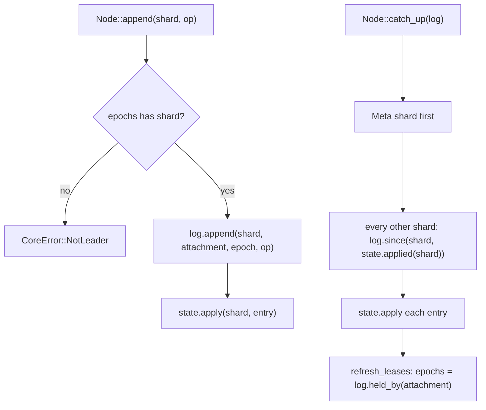
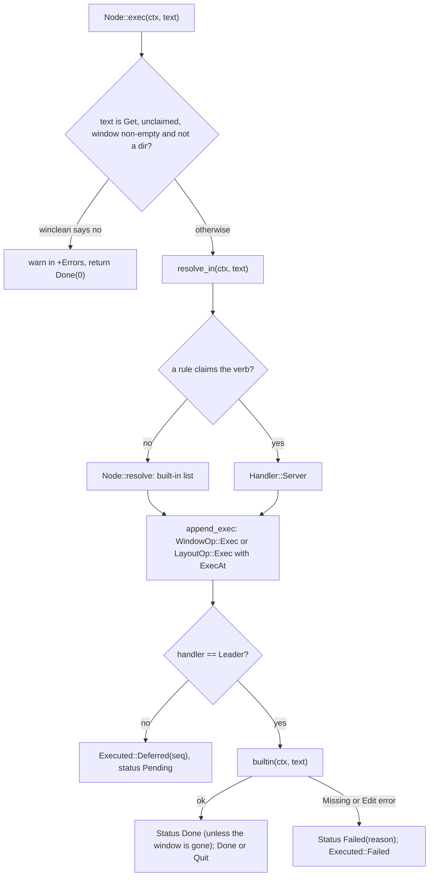
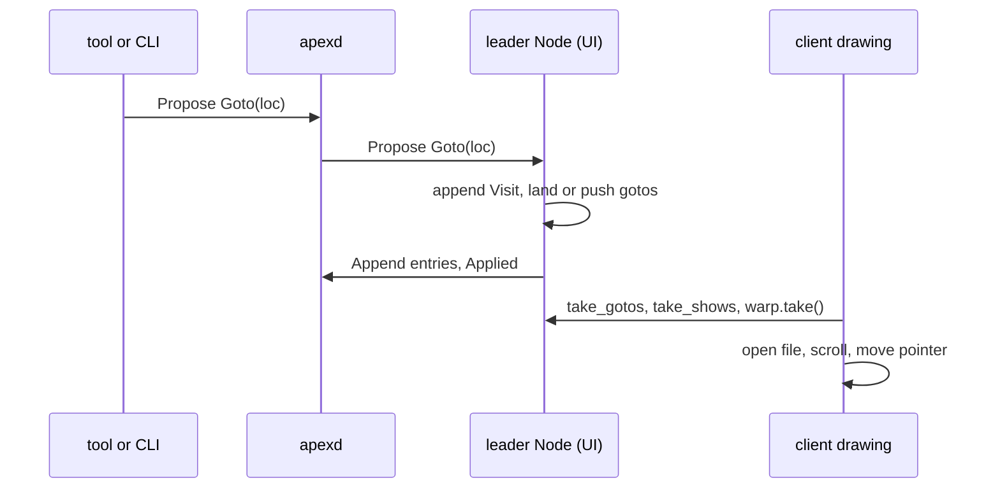

# The Node: Leading and Built-in Commands

`Node` (in `crates/apex-core/src/node.rs`) is a replica of a session. It is the one object that both the gpui client and the daemon use to read and change session state. Every node holds a full `State` and keeps it current by replaying the log. For the shards it holds a lease on, it is also the **leader**: it turns user actions into entries, appends them to the log and applies them. Those actions are typing, selecting, cut and paste, undo, Look, running an Edit program, and the built-in commands such as `New`, `Del`, `Zerox` and `Sort`. The module's own summary says it: "As leader of a shard a node performs the built-in commands, types, selects, and lowers Edit programs into entries; as follower it catches up." ([node.rs:1-4](crates/apex-core/src/node.rs#L1-L4))

This page sits between three others. [Sessions, Shards and Leadership](sessions-and-replication.md) explains leases and shards. [Entries, State and Apply](core-state.md) describes the entries a node writes and how `State::apply` interprets them. [Buffers, Views and Undo](buffers-and-text.md) explains what an edit entry does to a buffer. Pixel geometry is covered on [Tiling and Layout](tiling-and-layout.md) and the Edit language on [The Edit Language](edit-language.md). Changes made by others reach a node as proposals, described in [Proposals](proposals.md).

## Who runs a Node

The UI client and the daemon both build nodes with `Node::new(attachment)`. Tools and the CLI build them through `Remote`.

| Where | Attachment | Role |
|---|---|---|
| `apex-client` `Acme` ([app.rs:747](crates/apex-client/src/app.rs#L747), [app.rs:829](crates/apex-client/src/app.rs#L829)) | the UI's own | Leads buffers, windows and layout once it takes the leases; supplies real font metrics by replacing `node.tiling` ([app.rs:2641](crates/apex-client/src/app.rs#L2641)) |
| `apexd` session view ([daemon.rs:386](crates/apex-server/src/daemon.rs#L386)) | `SERVER` | Follows UI-led shards; leads them itself while no UI is attached, applying proposals as a headless leader |
| `Server` in `apex-server` ([lib.rs:182](crates/apex-server/src/lib.rs#L182)) | `SERVER` | The replica the server reads from |
| `Remote` for tools and the CLI ([remote.rs:257](crates/apex-server/src/remote.rs#L257)) | the tool's | Follower only; changes things by proposing |

A headless leader uses the default `tiling::Headless` metrics ([node.rs:284](crates/apex-core/src/node.rs#L284)). When the daemon leads (`s.leader.is_none()`), it applies its own proposals in a loop, drains one of the effect queues below (`gotos`), opening files and landing on them itself, then polls the server for execs it must perform and for notification changes (`status_flags`) until nothing more is proposed. The other queues are left to fill or, for `client_finds`, capped.

Sources: [crates/apex-core/src/node.rs:1-4](crates/apex-core/src/node.rs#L1-L4), [crates/apex-core/src/node.rs:267-288](crates/apex-core/src/node.rs#L267-L288), [crates/apex-server/src/daemon.rs:1522-1552](crates/apex-server/src/daemon.rs#L1522-L1552), [ARCHITECTURE.md:27-38](ARCHITECTURE.md#L27-L38)

## The Node struct

```rust
pub struct Node {
    pub state: State,
    pub attachment: AttachmentId,
    epochs: BTreeMap<Shard, Epoch>,      // leases this node believes it holds
    next_id: u64,
    next_group: u64,
    typing: Option<(ViewId, GroupId)>,   // the run of typing and its undo group
    pub seltext: Option<ViewId>,         // acme's seltext
    pub shows: Vec<(ViewId, usize)>,
    pub gotos: Vec<Loc>,
    pub client_finds: Vec<(WindowId, String, bool)>,
    pub switches: Vec<Loc>,
    pub quit_requested: bool,
    warned: BTreeMap<WindowId, Version>, // Del's warn-once memory
    edit: EditLang,                      // the Edit interpreter (remembers the last regexp)
    pub tiling: Box<dyn tiling::Info + Send + Sync>,
    pub warp: Option<Warp>,
    pub activecol: Option<ColumnId>,     // acme's activecol
}
```

Only `state` is replicated. Everything else belongs to this node alone:

- **Interaction state:** `typing`, `seltext`, `activecol` and `warned`. These follow acme's globals of the same names.
- **Effect queues:** `warp`, `shows`, `gotos`, `client_finds`, `switches` and `quit_requested`. They record what a client showing this replica should do next.

The [architecture review](#the-reviews-view) singles out both groups as UI concerns that leak into the core.

Sources: [crates/apex-core/src/node.rs:221-261](crates/apex-core/src/node.rs#L221-L261)

## Replication: following and leading



**Catching up.** `catch_up` applies, shard by shard, every entry the state has not yet seen. The metalog comes first, so shard creations and leases are known before the entries that depend on them ([node.rs:324-345](crates/apex-core/src/node.rs#L324-L345)). It then refreshes `epochs` from the log store rather than from state: the log store is the fencing authority, and a mirror knows the leases the server will honour.

**Leading.** `leads(shard)` is just `epochs.contains_key(&shard)` ([node.rs:317](crates/apex-core/src/node.rs#L317)). `append` ([node.rs:351](crates/apex-core/src/node.rs#L351)) looks up the epoch it holds for the shard, has the log sequence and fence the entry, and applies the result locally. It returns the entry's `Seq` and the `Applied` value from `State::apply`; `undo` uses that value to learn what range to select. Every leader operation on this page eventually goes through `append`.

**Shards and leases.**
- `create_shard` ([node.rs:360](crates/apex-core/src/node.rs#L360)) catches up first, appends the metalog entries the log store makes, and applies them. On a mirror log (a client's copy, with a hook to the server) the server's metalog entry arrives later; until then the node inserts the shard into `state.meta.shards` so entries for it can apply.
- `delete_shard` ([node.rs:374](crates/apex-core/src/node.rs#L374)) does the mirror case the other way round, applying a fake, unsequenced `ShardDel` through `State::apply_unsequenced`.
- `take_lease` and `release_lease` wrap the log's `grant` and `release` ([node.rs:388-403](crates/apex-core/src/node.rs#L388-L403)).

**Ids without coordination.** `alloc` puts the attachment id in the top bits and a per-node counter in the low 40 bits. Undo groups are built the same way (`new_group`). Two leaders can therefore never mint the same `BufferId`, `WindowId`, `ColumnId` or `GroupId` ([node.rs:304-315](crates/apex-core/src/node.rs#L304-L315)).

The tests rely on one property throughout: after any sequence of leader operations, a fresh follower that replays the log reaches the same `State::hash` ([tests/core.rs:8-47](crates/apex-core/tests/core.rs#L8-L47)).

Sources: [crates/apex-core/src/node.rs:290-403](crates/apex-core/src/node.rs#L290-L403), [crates/apex-core/src/log.rs:267-273](crates/apex-core/src/log.rs#L267-L273), [crates/apex-core/tests/core.rs:8-47](crates/apex-core/tests/core.rs#L8-L47)

## Making buffers, windows and columns

A buffer is its own shard. `create_buffer_as` allocates a `BufferId`, creates `Shard::Buffer(id)` and appends `BufferOp::Create` with name, text, disk hash, `WinKind` and the scratch flag ([node.rs:413-418](crates/apex-core/src/node.rs#L413-L418)).

`init_session` sets up a new session ([node.rs:425](crates/apex-core/src/node.rs#L425)):
1. It makes the top row's tag buffer, holding `TOP_TAG` (`"Newcol Newterm Win Web Kill Putall Exit End "`), with the `ViewId::Top` view.
2. It creates the layout shard with `LayoutOp::Init` and a guessed 1100×700 rectangle.
3. It makes two columns with `new_column`, as acme's `-c 2` does, and returns the last one.

`new_column` ([node.rs:436](crates/apex-core/src/node.rs#L436)) gives each column a tag buffer holding `COL_TAG` (`"New Cut Paste Snarf Sort Zerox Delcol "`) and adds it with `tiling::rowadd`. If there is no room it deletes the tag's shard again and fails with "no room for a column". `arrange_dropping` ([node.rs:451](crates/apex-core/src/node.rs#L451)) is `arrange` plus deletion of the tags of any columns a drag left empty and so removed from the layout.

A window is three things:
- a tag buffer holding only `WIN_TAG` (`"Look "`);
- a `Shard::Window` whose first entry is `WindowOp::Create { tag, body, path, label, via, base }`;
- a view (`ViewAdd`) on the tag buffer and, for text or buffer-page bodies, on the body buffer.

`make_window_shards` ([node.rs:521](crates/apex-core/src/node.rs#L521)) does these three; the rest of a tag (the path, the label and apex's own words) is not text in the tag. It is computed from state by `window_verbs`.

`place` ([node.rs:747](crates/apex-core/src/node.rs#L747)) then lays the window out with `tiling::coladd` and appends the whole new layout as one `LayoutOp::Arrange`. It sends a window meant for a column hidden behind a maximised one, or put away as a strip, to the column that shows windows (`tiling::nearest_open`), and puts a *diagnostic* window straight into the stash with no warp. Every layout change in the node works this way: clone `state.layout`, run a function from `tiling`, and `arrange` the result ([node.rs:290-294](crates/apex-core/src/node.rs#L290-L294)).

Other constructors follow the same pattern:

| Function | What it makes |
|---|---|
| `new_window`, `new_window_as(spec)` | A window on a new buffer; `Spec` gives kind, scratch, label and diagnostic ([node.rs:68-85](crates/apex-core/src/node.rs#L68-L85)) |
| `open_window`, `open_window_at` | A window on an existing buffer |
| `make_window` | acme's `makenewwindow` ([node.rs:587](crates/apex-core/src/node.rs#L587)): picks `activecol`, else the column of `seltext`, else of `from`, else a fallback; un-fulls the column; picks a y; grows the window if it has fewer than two lines |
| `open_term_window` | A `Body::Term` window |
| `open_page`, `open_web_window`, `open_html_window` | `Body::Page` windows (see [The I/O Plane and Pages](io-plane-and-pages.md)) |
| `cover_window`, `swap_window`, `raise_window` | Window stacks: one window over another in the same place |
| `zerox` | Another window on the same body buffer, keeping its label ([node.rs:1300](crates/apex-core/src/node.rs#L1300)) |
| `delete_window` | Drops views, restacks or closes or unstashes, deletes the window and tag shards, and deletes the body shard with its last view |
| `delete_column` | Fails with "column not empty" if it has windows; otherwise `rowclose`, then deletes the tag shard |

Setters change a window's replicated description: `set_window_path` (renames the buffer of a text window, or sets `WindowOp::Path`), `set_window_label`, `set_window_status` (below), and `web_navigate`, which only moves a URL page's path ([node.rs:684-743](crates/apex-core/src/node.rs#L684-L743)).

Some layout helpers are used by many callers: `refit_window` re-fits a window whose tag changed shape, as acme's `winsettag` does; `uncover` brings out a column that hides a window the user is being taken to; `reveal` raises a covered window, unstashes a stashed one, un-fulls what hides it and grows a window that shows no lines. `notice` is described under [notifications](#window-flags-status-and-notifications).

`delete_window` ([node.rs:1312](crates/apex-core/src/node.rs#L1312)) sets `warp` to `Warp::Closed { window, next }` so the client can move the pointer as acme's `colclose` does. It also clears `seltext` and `warned` for the window.

Sources: [crates/apex-core/src/node.rs:405-640](crates/apex-core/src/node.rs#L405-L640), [crates/apex-core/src/node.rs:684-850](crates/apex-core/src/node.rs#L684-L850), [crates/apex-core/src/node.rs:1298-1356](crates/apex-core/src/node.rs#L1298-L1356)

## Editing as leader

All text changes go through one private helper:

```rust
fn edit_op(&mut self, log: &mut Log, buffer: BufferId, q0: usize, nd: usize, text: &str, group: GroupId) -> Result<()> {
    let version = self.state.buffer(buffer)?.version;
    self.append(log, Shard::Buffer(buffer), Op::Buffer(BufferOp::Edit { version, q0, nd, text: text.into(), group }))?;
    Ok(())
}
```

Each edit carries the buffer's current version and an undo `GroupId` ([node.rs:1405](crates/apex-core/src/node.rs#L1405)). Selections are separate `BufferOp::Select` entries, sequenced in the same shard so every replica agrees on where each view's dot is.

**Typing groups.** `typing` remembers the view being typed into and its group. `typing_group(view)` ([node.rs:1389](crates/apex-core/src/node.rs#L1389)) reuses that group for consecutive keystrokes in the same view, so a run of typing undoes as one step. A mouse selection, a command (`exec` calls `end_typing()` first), `set_content`, `cut`, `undo` and the other non-typing operations start a new group. The test `typing_undoes_as_one_group_until_a_mouse_action` checks exactly this ([tests/core.rs:101-117](crates/apex-core/tests/core.rs#L101-L117)).

| Operation | What it appends |
|---|---|
| `insert(view, text)` | Edit replacing the selection, then Select at its end. A newline in a body with `autoindent` copies the previous line's leading blanks. |
| `erase(view, Erase::{Char,Line,Word})` | acme's ^H/^U/^W. A non-empty selection is snarfed and cut first; the width comes from `bswidth` (acme's `textbswidth`) and never erases before the view's origin. |
| `backspace`, `delete_forward` | One rune either side, or the selection |
| `replace_selection` | Edit in a fresh group, then select the inserted text (acme's Paste) |
| `snarf`, `cut`, `paste` | `LayoutOp::Snarf` (the snarf buffer lives in the layout shard), plus the edit |
| `undo`, `redo` | `BufferOp::Undo`/`Redo { version }`; if apply returns `Applied::UndoRange(Some(..))`, a Select of that range. Returns `false` when the stack is empty. |
| `set_content` | The whole text replaced in one group (Get, watcher reload) |
| `insert_text`, `replace_text`, `delete_runs` | Edits at an address without touching dots beyond the shift (for tools, and Put's trim) |
| `select`, `set_origin` | `Select` (also sets `seltext`), `Origin` |

Sources: [crates/apex-core/src/node.rs:1117-1153](crates/apex-core/src/node.rs#L1117-L1153), [crates/apex-core/src/node.rs:1389-1612](crates/apex-core/src/node.rs#L1389-L1612), [crates/apex-core/tests/core.rs:77-117](crates/apex-core/tests/core.rs#L77-L117)

## Look

`look_dir(view, needle, reverse)` ([node.rs:1685](crates/apex-core/src/node.rs#L1685)) is acme's `search`: a literal search over the buffer's runes, with the hit becoming the view's selection and `seltext`. `look` is the forward form ([node.rs:1678](crates/apex-core/src/node.rs#L1678)).
- **Forward**, it searches from the selection's end to the end of the text, then wraps from 0.
- **Backward** (shift-B3), it takes the last match ending at or before the selection's start, then wraps from the end.

It returns whether anything was found (tested in [tests/core.rs:559-588](crates/apex-core/tests/core.rs#L559-L588)).

The tag's `Look` word has its own helpers:
- `look_arg(w)` ([node.rs:1622](crates/apex-core/src/node.rs#L1622)) finds the first `Look` in a window's tag and parses its argument into a `LookArg` (position, argument, `live`, `closed`). The argument is the word after `Look`; `Look/word` marks it as *live* (searched for as it is typed); a closing slash lets it hold spaces, as in `Look/two words/`.
- `set_look_arg` rewrites that argument as `/arg/` after a B3 look ([node.rs:1646](crates/apex-core/src/node.rs#L1646)).
- `make_look_live` adds the slashes ([node.rs:1663](crates/apex-core/src/node.rs#L1663)).
- `look_spaced` normalises `Look/x/` to `Look x` before commands are resolved ([node.rs:52](crates/apex-core/src/node.rs#L52)).

Pages and terminals have no buffer to search. For these, `found_by_client(ctx)` returns the window, and the `Look` is queued with `find_in_client`, which keeps at most 8 because a leader with no screen never takes them ([node.rs:1914-1932](crates/apex-core/src/node.rs#L1914-L1932)). Both the `Look` built-in and the B3 path use it.

The B3 path is `Proposal::Look` in the server's `proposal::apply` ([proposal.rs:385-425](crates/apex-server/src/proposal.rs#L385-L425)). After the client-find check, it picks the view to search from the context:
- B3 in a window searches that window's **body**, even when the click was in its tag, as acme's `look3` does. It does not use `seltext`, which a window never selected in would not own.
- B3 in a column tag or the top row searches the last-selected text if that view still has a buffer; otherwise it searches the tag itself.

When `look_dir` finds something, it calls `reveal` on the window, unless that window is stashed, because a stashed window being looked at in the stash preview stays stashed. It then sets `warp = Warp::Sel(v)` and, if the look came from the same window, records the word with `set_look_arg`.

`double_click` and `acme_isalnum` are acme's `textdoubleclick` and `isalnum`, also in this module ([node.rs:105-187](crates/apex-core/src/node.rs#L105-L187)). The `the_first_look_in_a_tag_has_the_word_looked_for` test covers the tag argument ([tests/core.rs:918-983](crates/apex-core/tests/core.rs#L918-L983)).

Sources: [crates/apex-core/src/node.rs:17-64](crates/apex-core/src/node.rs#L17-L64), [crates/apex-core/src/node.rs:1614-1718](crates/apex-core/src/node.rs#L1614-L1718), [crates/apex-server/src/proposal.rs:385-425](crates/apex-server/src/proposal.rs#L385-L425)

## Lowering Edit programs

`run_edit(window, program)` ([node.rs:1782](crates/apex-core/src/node.rs#L1782)) runs a sam-style Edit program against a snapshot of the body's text, dot and name, using the node's own `apex_edit::Edit` instance. That instance remembers the last regexp across programs. It then lowers the result:

1. Every change becomes an `edit_op` in **one** new undo group, so the whole program undoes at once.
2. The resulting dot becomes a `Select`.
3. `Intent::Undo { n }` is performed here as `n` undos, or `-n` redos.
4. Every other intent, along with the output and warnings, is returned in `EditRun` ([node.rs:213-219](crates/apex-core/src/node.rs#L213-L219)).

The `Edit` built-in appends the output and each warning to the window's +Errors. It then fails with "Edit: file and pipe commands are not supported here yet" if any intents remain ([node.rs:2202-2215](crates/apex-core/src/node.rs#L2202-L2215)). The changes are applied before that error is raised. Errors from the Edit language come back as `CoreError::Edit`. A server-side `Proposal::Edit` takes the same route, running `Edit {program}` through `exec` ([proposal.rs:445-448](crates/apex-server/src/proposal.rs#L445-L448)). See [tests/core.rs:119-140](crates/apex-core/tests/core.rs#L119-L140).

Sources: [crates/apex-core/src/node.rs:213-219](crates/apex-core/src/node.rs#L213-L219), [crates/apex-core/src/node.rs:1780-1813](crates/apex-core/src/node.rs#L1780-L1813), [crates/apex-core/tests/core.rs:119-140](crates/apex-core/tests/core.rs#L119-L140)

## Commands: exec entries, handlers and statuses

Every B2 command, whether from a tag, the body, the CLI or `apex exec`, becomes an **exec entry** before anything runs. This makes the command visible to every replica, and lets the server or a tool perform it.



### Types

| Type | Defined in | Meaning |
|---|---|---|
| `ExecCtx` | [ids.rs:124](crates/apex-core/src/ids.rs#L124) | Where B2 happened: `Window(w)`, `Column(c)`, or `Top` |
| `Handler` | [entry.rs:148-155](crates/apex-core/src/entry.rs#L148-L155) | `Leader` (built-ins), `Server` (files, processes, terminals, the plumber), `Tool(name)` |
| `ExecAt` | [entry.rs:159-164](crates/apex-core/src/entry.rs#L159-L164) | The target buffer, its version and the selection at the time, "so readers never guess at cross-shard order" |
| `ExecOp` | [entry.rs:168-172](crates/apex-core/src/entry.rs#L168-L172) | `text`, `handler`, `at` |
| `ExecStatusOp` | [entry.rs:176-181](crates/apex-core/src/entry.rs#L176-L181) | `Done`, `Failed(reason)`, `Unknown` (the performer died before reporting) |
| `ExecRecord`, `ExecStatus` | [state.rs:15-44](crates/apex-core/src/state.rs#L15-L44) | The applied record; status starts `Pending` |
| `Executed` | [node.rs:200-211](crates/apex-core/src/node.rs#L200-L211) | `Done(seq)`, `Deferred(seq)`, `Failed(seq, reason)`, `Quit(seq)` |

A window's execs are stored in its window shard (`WindowOp::Exec` and `WindowOp::Status`), keyed by the exec entry's sequence number. Execs from a column tag or the top row go in the layout shard (`LayoutOp::Exec { ctx, op }` and `LayoutOp::Status`) ([node.rs:2042-2060](crates/apex-core/src/node.rs#L2042-L2060), [state.rs:683-708](crates/apex-core/src/state.rs#L683-L708)). The performer reports an outcome with `append_status`. `ExecAt` is filled by `exec_at` from `edit_target(ctx)`. In a window, that is `seltext` if it is a non-empty selection in the same window, and otherwise the window's body. Elsewhere it is `seltext` ([node.rs:2019-2040](crates/apex-core/src/node.rs#L2019-L2040)).

### Resolution

`Node::resolve(text)` is a static list ([node.rs:2063-2074](crates/apex-core/src/node.rs#L2063-L2074)):
- Text starting with `|`, `<` or `>` goes to the server.
- These first words are `Leader`: `Cut Paste Snarf Undo Redo Look Edit Newcol Delcol Del Delete Zerox Stash Swap Font Sort Exit Tab Indent ID Send`. So is `New` with no argument.
- Everything else is `Server`, including `Get`, `Put`, `Kill`, `New name` and external commands.

`resolve_in` asks the replicated rule table first. If a plumbing rule restricted to some windows claims the verb (`claimed`, which calls `plumb::claims_verb`), the handler is `Server`, and the server walks the rules ([node.rs:2081-2096](crates/apex-core/src/node.rs#L2081-L2096)). `Send` in a terminal window is also forced to `Server` so the shell receives it. If a claiming tool declines, the server sends `Proposal::Builtin` ([lib.rs:1106-1107](crates/apex-server/src/lib.rs#L1106-L1107)), which calls `run_builtin`. That runs apex's own meaning without appending another status, because the walk owns the exec entry ([node.rs:2154-2163](crates/apex-core/src/node.rs#L2154-L2163), [proposal.rs:373-376](crates/apex-server/src/proposal.rs#L373-L376)).

Execs deferred to the server are picked up by `Server::poll_execs` ([lib.rs:1029](crates/apex-server/src/lib.rs#L1029)). It scans every window's and the layout's execs for `Handler::Server` with status `Pending` that it has not already performed, performs each one once, and answers with proposals that end in a `Proposal::Status`, which `proposal::apply` turns into `append_status` unless the window is gone ([proposal.rs:302-312](crates/apex-server/src/proposal.rs#L302-L312)). See [The Server](server.md).

### The built-ins

`builtin` returns `Ok(true)` only for `Exit` ([node.rs:2166-2333](crates/apex-core/src/node.rs#L2166-L2333)). If a built-in returns `CoreError::Missing`, its message becomes the `Failed` reason.

| Command | Behaviour |
|---|---|
| `Cut` `Paste` `Snarf` `Undo` `Redo` | On `edit_target(ctx)`; nothing if there is none |
| `Look [text]` | Searches the body for the text, or for the body's selection; in pages and terminals, queued for the client |
| `Edit prog` | `run_edit`; output and warnings go to +Errors |
| `New` | A new empty buffer in a window placed by `make_window`; makes a column if there are none; sets `seltext` to it |
| `Newcol` | A new column with one empty window |
| `Delcol` | `colclean` (warn once per dirty window), then deletes every window and the column |
| `Del` / `Delete` | `Delete` forces. `Del` closes at once if another body view of the buffer remains (`window_last_view` is false), or `winclean` allows it |
| `Stash`, `Swap` | `stash_window`, `swap_window` |
| `Zerox` | `zerox`; on a directory, an error ("is a directory; Zerox illegal") |
| `Tab n` / `Tab` | `WindowOp::Tab`; with no number, reports the tab stop in +Errors |
| `Indent on/off` | `WindowOp::Indent`; anything else fails with "Indent on\|off" |
| `ID` | The window id, written to +Errors |
| `Send` | On a text window: the selection, or else the snarf buffer, appended to the body with a newline |
| `Font` | Toggles `WindowOp::Font { mono }` |
| `Sort` | `sort_column`, sorting windows by path |
| `Exit` | Sets `quit_requested`; returns `Executed::Quit` |

After a successful built-in, `exec` appends `Done` unless the window no longer exists. `Del` removes the window's log, and in that case the metalog's `ShardDel` is the record ([node.rs:2125-2144](crates/apex-core/src/node.rs#L2125-L2144)). `Proposal::Exec` turns an `Executed::Failed` into an error for the proposer ([proposal.rs:430-441](crates/apex-server/src/proposal.rs#L430-L441)).

Sources: [crates/apex-core/src/node.rs:2016-2333](crates/apex-core/src/node.rs#L2016-L2333), [crates/apex-core/src/entry.rs:146-181](crates/apex-core/src/entry.rs#L146-L181), [crates/apex-core/src/state.rs:15-44](crates/apex-core/src/state.rs#L15-L44), [crates/apex-server/src/lib.rs:1029-1042](crates/apex-server/src/lib.rs#L1029-L1042), [crates/apex-server/src/lib.rs:1092-1108](crates/apex-server/src/lib.rs#L1092-L1108), [crates/apex-server/src/proposal.rs:373-376](crates/apex-server/src/proposal.rs#L373-L376), [crates/apex-core/tests/core.rs:142-244](crates/apex-core/tests/core.rs#L142-L244)

## Dirty checks: Del, Get, Delcol and End

`window_unsaved(w)` decides whether a window holds edits a file has not had. It is false for scratch windows, directories, windows owned by a tool and live windows. Otherwise it is the body buffer's `dirty()` ([node.rs:2341-2350](crates/apex-core/src/node.rs#L2341-L2350)).

`winclean(w)` is acme's warn-once rule, with these cases ([node.rs:1724-1748](crates/apex-core/src/node.rs#L1724-L1748)):
- If the window is not unsaved, it returns `true` at once.
- Otherwise it writes `NAME modified` (or `unnamed file modified`) to the window's +Errors and returns `false`.
- It records the buffer's version in `warned`. Asked again at the same version, it returns `true`.
- Any edit after the warning bumps the version, so the next request warns again.
- An unnamed buffer shorter than 100 runes is never warned about.

`winclean` is used by:
- `Del`;
- `Delcol` through `colclean` ([node.rs:1771](crates/apex-core/src/node.rs#L1771));
- `End` through `session_clean`, which asks once per buffer rather than once per window ([node.rs:1757-1768](crates/apex-core/src/node.rs#L1757-L1768));
- **`Get`'s dirty check**. Before resolving a bare `Get` (when no rule claims it), `exec` calls `winclean` on a non-empty, non-directory window. If that refuses, it returns `Executed::Done(0)` without appending an exec entry, so the server never reloads over unsaved edits until the user asks a second time ([node.rs:2101-2109](crates/apex-core/src/node.rs#L2101-L2109)).

`window_verbs(w)` computes the words drawn before the tag's text, as acme's `winsettag1` does ([node.rs:1251-1296](crates/apex-core/src/node.rs#L1251-L1296)):
- always `Del` and `Snarf`;
- for a window with a file menu (not owned by a tool, not scratch): `Undo` and `Redo` when their stacks are non-empty, `Put` when the buffer is dirty, named, not a directory and not live, and `Get` only when the buffer is stale;
- `Swap` when the window covers another;
- `Back Fwd Get` on URL pages;
- `Send` on terminals.

Sources: [crates/apex-core/src/node.rs:1251-1296](crates/apex-core/src/node.rs#L1251-L1296), [crates/apex-core/src/node.rs:1720-1778](crates/apex-core/src/node.rs#L1720-L1778), [crates/apex-core/src/node.rs:2101-2109](crates/apex-core/src/node.rs#L2101-L2109), [crates/apex-core/src/node.rs:2335-2350](crates/apex-core/src/node.rs#L2335-L2350), [crates/apex-core/tests/core.rs:174-216](crates/apex-core/tests/core.rs#L174-L216), [crates/apex-core/tests/core.rs:490-538](crates/apex-core/tests/core.rs#L490-L538)

## +Errors windows

`error_dir(w)` is acme's `errorwin`: the directory a window's errors belong to ([node.rs:1818](crates/apex-core/src/node.rs#L1818)):
- a file window's parent directory;
- the path itself for a directory, an errors window or a terminal;
- `None` for unnamed windows and URL pages, which use the session's errors window.

`errors_path(dir)` turns the directory into the window's path, with a trailing slash, or the empty string for the session's own ([node.rs:2364-2369](crates/apex-core/src/node.rs#L2364-L2369)).

`errors(dir, text)` is acme's `errorwin1` ([node.rs:1849-1872](crates/apex-core/src/node.rs#L1849-L1872)):
1. It finds the `WinKind::Errors` window at that path, or makes one in the last column (creating a column if there is none). A new one is scratch and diagnostic, so `place` creates it already stashed.
2. It appends the text at the end in its own undo group.
3. It selects the new text.
4. It pushes `(view, q0)` onto `shows` so the client can bring the start of the new text into view.

The client does not show a diagnostic window it has not opened. It reports the news in a toast instead (`diagnostic_news`), and skips the `show` for such a window ([app.rs:1929-1940](crates/apex-client/src/app.rs#L1929-L1940)). Server-side command output reaches +Errors through `Proposal::Errors` ([proposal.rs:294-297](crates/apex-server/src/proposal.rs#L294-L297)).

Sources: [crates/apex-core/src/node.rs:1815-1872](crates/apex-core/src/node.rs#L1815-L1872), [crates/apex-core/src/node.rs:2362-2369](crates/apex-core/src/node.rs#L2362-L2369), [crates/apex-core/tests/core.rs:456-488](crates/apex-core/tests/core.rs#L456-L488)

## Window flags, status and notifications

The node provides read-only views over replicated window flags ([node.rs:1160-1249](crates/apex-core/src/node.rs#L1160-L1249)):

| Function | Meaning |
|---|---|
| `window_owner(w)` | The owning tool's attachment name (`WindowOp::Own`), while that attachment is still attached |
| `window_live(w)` | A terminal whose program has not exited, or a text window kept live (`WindowOp::Live`) by an attachment still here |
| `window_status(w)` | The window's `WindowStatus`, while whoever said it is here: the session's own (`SERVER`) always counts as present, a tool's goes with its attachment |
| `window_working(w)`, `window_progress(w)` | Derived from the status: its state is `Working`, and its percentage while it is |
| `window_diagnostic(w)` | `WindowOp::Diagnostic` |
| `window_kind`, `window_path`, `window_label`, `window_scratch` | What the window is, where, and whether a file is behind it |

**Status.** A window's status replaced the older working flag. `set_window_status` ([node.rs:713](crates/apex-core/src/node.rs#L713)) appends `WindowOp::ProgramStatus { status }` ([entry.rs:216](crates/apex-core/src/entry.rs#L216)), and `State::apply` stores it in `Window.status` ([state.rs:675](crates/apex-core/src/state.rs#L675)). A `WindowStatus` carries `state`, `kind`, `progress`, `msg`, `by` and `since` ([state.rs:88-102](crates/apex-core/src/state.rs#L88-L102)). Before appending, the node trims the message and, if state, kind and message are the same as what is there, keeps the old `since`, so only the progress moves and the age is not reset. It appends nothing if nothing changed. Others reach it through `Proposal::SetStatus` ([proposal.rs:264-267](crates/apex-server/src/proposal.rs#L264-L267)). What the states mean, and where reports come from, is on [Program Status Protocol (OSC 7501)](program-status.md).

**Notifications.** They are metalog state (`MetaOp::Notify` and `Unnotify`, [entry.rs:538-541](crates/apex-core/src/entry.rs#L538-L541); applied at [state.rs:883-887](crates/apex-core/src/state.rs#L883-L887)). The metalog is pinned to the daemon, so a node never raises them itself. `notifications()` lists them oldest first, skipping any whose window is gone, and `window_notified(w)` asks about one window ([node.rs:1194-1202](crates/apex-core/src/node.rs#L1194-L1202)). A window's notification follows its status: the server's `status_flags` ([lib.rs:576-596](crates/apex-server/src/lib.rs#L576-L596)) raises one, in the name of whoever set the status, when the status comes to ask for the user (done, blocked or error), and lowers it when the status no longer asks. The daemon calls it after each round of proposals, whether or not it leads ([daemon.rs:1548](crates/apex-server/src/daemon.rs#L1548), [daemon.rs:1556](crates/apex-server/src/daemon.rs#L1556)). The one leader-side policy is `notice(w)` ([node.rs:859](crates/apex-core/src/node.rs#L859)), applied through `Proposal::Notice` ([proposal.rs:455](crates/apex-server/src/proposal.rs#L455)). It rearranges the layout just enough that a notified window is not hidden behind a maximised column or window. Behaviour is covered by `notifications_are_a_windows_and_go_with_it`, `a_notified_window_is_not_left_hidden` and `a_diagnostic_window_is_made_stashed_and_says_how_far_along` ([tests/core.rs:606-660](crates/apex-core/tests/core.rs#L606-L660), [tests/core.rs:798-880](crates/apex-core/tests/core.rs#L798-L880)).

Sources: [crates/apex-core/src/node.rs:710-727](crates/apex-core/src/node.rs#L710-L727), [crates/apex-core/src/node.rs:859-885](crates/apex-core/src/node.rs#L859-L885), [crates/apex-core/src/node.rs:1160-1249](crates/apex-core/src/node.rs#L1160-L1249), [crates/apex-core/src/state.rs:74-110](crates/apex-core/src/state.rs#L74-L110), [crates/apex-core/src/entry.rs:538-541](crates/apex-core/src/entry.rs#L538-L541), [crates/apex-server/src/lib.rs:576-596](crates/apex-server/src/lib.rs#L576-L596), [crates/apex-server/src/daemon.rs:1544-1557](crates/apex-server/src/daemon.rs#L1544-L1557)

## Navigation stacks

The session's back and forward stacks are in the layout shard (`layout.nav_back` and `layout.nav_forward`), so a session re-attached elsewhere keeps its history. Their elements are `Loc { session, name, pos }`, where `Pos` is `Keep`, `Chars(q0, q1)`, `Line(n)` (1-based) or `LineCol(line, col)` (0-based, UTF-16 columns as language servers count them) ([entry.rs:420-440](crates/apex-core/src/entry.rs#L420-L440)).

Two entries change the stacks ([state.rs:728-746](crates/apex-core/src/state.rs#L728-L746)):
- `LayoutOp::Visit { from, to }` pushes `from` (when there is one) onto the back stack and clears the forward stack. It skips duplicates and a `from` equal to `to`, and caps the stack at 50.
- `LayoutOp::NavPop { back, at }` pops one stack and pushes `at` (when there is one) onto the other.

The proposals `Goto`, `Follow` and `Nav` write them ([proposal.rs:328-361](crates/apex-server/src/proposal.rs#L328-L361)):
- `Goto` and `Follow` share `goto_from`: append `Visit`, then either queue the place on `switches` (another session) or `land` on it, falling back to `gotos` when its window is not open ([proposal.rs:162-174](crates/apex-server/src/proposal.rs#L162-L174)). `Goto` records `current_loc()` as the place left; `Follow` records the page's own place, `page_loc(from)`, when the link was followed from a page.
- `Nav` fails with "nothing to go back to" or "nothing to go forward to" on an empty stack. Otherwise it appends `NavPop`, fails if the place was a page that has since closed (`gone_page`), and goes there the same way.
- `Switch` simply queues a `Loc` on `switches`.

They use these Node helpers:

| Helper | Role |
|---|---|
| `current_loc()` | Where the user is: `seltext`'s window and its dot, with the session id; `None` for an unnamed window |
| `page_loc(w)` | A page's place: its window id as the name, `Pos::Keep` |
| `elsewhere(loc)` | Whether the place names another session (by id, id prefix or label) |
| `window_named(name)` | A window by numeric id or by path, preferring the file's own window over its errors window or page |
| `loc_range(w, pos)` | A `Pos` resolved to a rune range; a `Line` includes its newline, as acme's address does |
| `land(loc)` | For a page, just `reveal`. Otherwise select, `reveal`, set `seltext` and `warp = Warp::Sel` |

`web_navigate` deliberately does not touch these stacks. A page's link history belongs to its tool ([node.rs:739-741](crates/apex-core/src/node.rs#L739-L741)).

Sources: [crates/apex-core/src/node.rs:1874-2007](crates/apex-core/src/node.rs#L1874-L2007), [crates/apex-core/src/state.rs:728-746](crates/apex-core/src/state.rs#L728-L746), [crates/apex-core/src/entry.rs:420-440](crates/apex-core/src/entry.rs#L420-L440), [crates/apex-server/src/proposal.rs:162-174](crates/apex-server/src/proposal.rs#L162-L174), [crates/apex-server/src/proposal.rs:328-361](crates/apex-server/src/proposal.rs#L328-L361)

## Effect queues for the client

Some consequences of a leader operation are not state but instructions to whoever is drawing. The node collects them in fields that the owner drains:

| Field / taker | Filled by | Drained by |
|---|---|---|
| `warp: Option<Warp>` | `place`, `delete_window`, `grow_window`, drags, `land`, Look | The client moves the pointer as acme would ([app.rs:2415](crates/apex-client/src/app.rs#L2415)); variants `NewWindow`, `WinButton`, `Closed`, `ColButton`, `Sel` ([tiling.rs:157-171](crates/apex-core/src/tiling.rs#L157-L171)) |
| `shows` / `take_shows` | `errors`, `Proposal::Show` | The client scrolls the view to the position ([app.rs:1931](crates/apex-client/src/app.rs#L1931)) |
| `gotos` / `take_gotos` | `Goto`, `Follow` and `Nav` whose window is not open | The client opens the file and lands ([app.rs:1957](crates/apex-client/src/app.rs#L1957)); with no UI, the daemon opens and lands itself ([daemon.rs:1530-1542](crates/apex-server/src/daemon.rs#L1530-L1542)) |
| `client_finds` / `take_client_finds` | Look in a page or terminal | The client finds in the web view or the terminal's history ([app.rs:1943](crates/apex-client/src/app.rs#L1943)); capped at 8 |
| `switches` / `take_switches` | Goto, Follow, Nav or `Switch` naming another session | The UI switches sessions ([app.rs:1961](crates/apex-client/src/app.rs#L1961), [app.rs:2758](crates/apex-client/src/app.rs#L2758)) |
| `quit_requested` | `Exit` | The client closes its window after flushing ([app.rs:2817](crates/apex-client/src/app.rs#L2817)) |

The client's `sync` drains these after catching up ([app.rs:1916-1969](crates/apex-client/src/app.rs#L1916-L1969)).



Sources: [crates/apex-core/src/node.rs:228-260](crates/apex-core/src/node.rs#L228-L260), [crates/apex-core/src/tiling.rs:157-171](crates/apex-core/src/tiling.rs#L157-L171), [crates/apex-client/src/app.rs:1916-1969](crates/apex-client/src/app.rs#L1916-L1969), [crates/apex-server/src/daemon.rs:1522-1552](crates/apex-server/src/daemon.rs#L1522-L1552)

## Errors

Node operations return `Result<T, CoreError>` ([node.rs:87-101](crates/apex-core/src/node.rs#L87-L101)):

| Variant | Raised when |
|---|---|
| `Log(LogError)` | The log store rejects an append (fencing, wrong shard, missing shard) |
| `Apply(ApplyError)` | `State::apply` rejects the entry |
| `NotLeader(shard)` | `append` is called on a shard this node holds no lease on |
| `Missing(String)` | A user-level failure: "column not empty", "Del needs a window", "x: not a built-in", and similar |
| `Edit(apex_edit::Error)` | The Edit program fails |

`exec` turns `Missing` and `Edit` into a `Failed` status and `Executed::Failed`. All other errors propagate ([node.rs:2138-2143](crates/apex-core/src/node.rs#L2138-L2143)). `fencing_rejects_a_stale_leader` shows a node whose lease was taken failing to append ([tests/core.rs:246-272](crates/apex-core/tests/core.rs#L246-L272)).

Sources: [crates/apex-core/src/node.rs:87-101](crates/apex-core/src/node.rs#L87-L101), [crates/apex-core/src/node.rs:2125-2144](crates/apex-core/src/node.rs#L2125-L2144)

## The review's view

ARCHITECTURE.md §2, "UI in the core", criticises `node.rs`:
- The effect queues should become a returned `Effects` value or an injected sink.
- `seltext` and `activecol` are per-node focus, yet they decide the targets of replicated commands, so the same command can resolve differently on the server and on the UI.
- The layout API is in mouse vocabulary (button numbers, 5-pixel preview thresholds).
- Tag chrome (`window_verbs`, `look_arg`), UI built-ins (`Font`, `Exit`, `ID`, Look in pages) and `Get`'s dirty check sit in the core.
- `Node::resolve` keeps its own built-in list, separate from `plumb.rs::BUILTINS`.
- Placement policy, such as diagnostic windows made stashed and `notice`, belongs to the caller.

Some details of the review predate the current code. It names `page_finds` and `find_in_page`, which are now `client_finds` and `find_in_client`. It mentions a `Web` built-in in the core, but `Web` is no longer in `Node::resolve`. It says `web_navigate` pushes onto the back stack, but the code now says it does not. Its line numbers are also stale.

Sources: [ARCHITECTURE.md:335-415](ARCHITECTURE.md#L335-L415), [crates/apex-core/src/node.rs:2063-2074](crates/apex-core/src/node.rs#L2063-L2074), [crates/apex-core/src/node.rs:729-743](crates/apex-core/src/node.rs#L729-L743)
