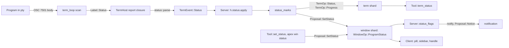

# Program Status Protocol (OSC 7501)

The Program Status Protocol lets a program running in an apex terminal say what it is doing: at rest, working (and how far along), finished, waiting on the user (and for what), or failed. The program writes an `OSC 7501` escape sequence. apex reads it and keeps the result as *records* in the terminal's replicated state. It also derives a *window status* from the records, and that status is what the user sees: a pill after the window's label, a row under its name in the sidebar, a turning handle while it works, and a notification when the status asks for the user.

The protocol's reading, limits and record life rules live in one dependency-light module, `apex-core`'s `status.rs`. The rest of the path runs through the terminal plumbing described in [Terminals](terminals.md). The term shard it writes to is described in [Entries, State and Apply](core-state.md), and the daemon that hosts the terminal is in [The Daemon (apexd)](daemon.md). Consumers include the agent tool ([Coding Agents](agent-tools.md)), the SDK ([Writing Tools](tool-sdk.md)) and the client ([Sessions, Tabs and Window Chrome](client-chrome.md)).

```
OSC 7501 ; state=working:app=brew:msg=<base64> ST
```

## Overview of the data path

Two things are kept, at two levels. The terminal carries every record its programs have reported (`Term::status`). The window carries one `WindowStatus`, the summary of the most pressing record, in `Window::status`. A tool, the `apex win status` command or the OSC 9;4 progress path can also set a window's status. So `WindowStatus` is the one thing every consumer reads, whoever said it. The window's *notification* is derived from that status too, not from the records (see below).



The program's bytes never reach the screen parser. `scan` in `term_loop.rs` cuts the sequence out of the stream and reports it as a label. The daemon leads the term shard, so it appends `TermOp::Status` and `TermOp::Progress` directly. The window's status is in the window shard, which it does not lead, so it goes by proposal (`Proposal::SetStatus`, see [Proposals](proposals.md)).

Sources: [crates/apex-core/src/status.rs:1-9](crates/apex-core/src/status.rs#L1-L9), [crates/apex-server/src/term_loop.rs:96-115](crates/apex-server/src/term_loop.rs#L96-L115), [crates/apex-server/src/lib.rs:653-773](crates/apex-server/src/lib.rs#L653-L773), [crates/apex-server/src/lib.rs:1975-1999](crates/apex-server/src/lib.rs#L1975-L1999)

## The wire format and its parser

A report body (after `7501;`) is a list of `key=value` pairs separated by `:`. `status::parse` turns it into a `Report`, which is either `Set(Record)` or `Clear(Option<String>)`.

| Key | Meaning | Rules in `parse` |
|---|---|---|
| `state` | `idle`, `working`, `done`, `blocked`, `error`, or `clear` | Required. Anything else discards the report. `clear` yields `Report::Clear`. |
| `id` | Names a record, with `/` giving hierarchy (e.g. `build/test`). | Optional. Absent means the root, stored as the empty string. At most 128 bytes, at most 8 segments, each non-empty, at most 32 bytes, and made of alphanumerics or `_.+-`. |
| `kind` | `permission`, `question` or `auth` | Kept only when the state is `blocked`. |
| `progress` | 0 to 100 | Kept only for `working` or `blocked`. Digits only (`+5` is rejected) and at most 100. |
| `app` | The program's name | At most 32 bytes, non-empty, id characters. A bad one is treated as absent. |
| `title`, `msg` | Free text, base64 | The encoded form is capped at 256 or 2732 bytes, the decoded form at 192 or 2048 bytes. No control characters. |

The state is `State { Idle, Working, Done, Blocked, Error }`, the kind is `Kind { Permission, Question, Auth }`, and the record is `Record { id, state, kind, progress, app, title, msg }`. Both enums have `name()` and `from_name()`.

Two failure policies sit side by side, and the tests pin both:

- **Malformed pairs are skipped.** A pair with no `=`, a key that is not lowercase letters, or a value with a byte outside `[A-Za-z0-9_.,+/=-]` is dropped and the rest is still read. Unknown keys are ignored. For repeated keys the last one wins.
- **Limit violations discard the whole report.** The cases are a body over 4088 bytes (`MAX_BODY = 4096 - 8`), a key over 16 bytes, a bad `id`, a missing or unknown `state`, bad base64 or non-UTF-8 text, text over its limit, and control characters in decoded text. `parse` returns `None`, and the terminal host's closure drops the event without comment.

Base64 is decoded by a small local routine. It accepts padded or unpadded standard base64 and rejects anything with non-zero leftover bits.

`encode` is the inverse of `parse`: it writes a record (or a clear of an id, or of everything) as a body. The `apex status` command uses it, and a unit test checks that what `encode` writes `parse` reads back as it was.

The query form is a body of just `?` (whitespace ignored), recognised by `is_query`. Programs use it to learn whether the terminal speaks the protocol (see below).

Sources: [crates/apex-core/src/status.rs:15-68](crates/apex-core/src/status.rs#L15-L68), [crates/apex-core/src/status.rs:93-168](crates/apex-core/src/status.rs#L93-L168), [crates/apex-core/src/status.rs:170-251](crates/apex-core/src/status.rs#L170-L251), [crates/apex-core/src/status.rs:395-402](crates/apex-core/src/status.rs#L395-L402)

## Records and their life

`Records` is a terminal's list of records, ordered by last report. Its methods encode the life rules:

| Method | Effect |
|---|---|
| `apply(Report::Set)` | Removes any record with the same `id`, pushes the new one at the end (replacement is **whole**, so a key left out is gone). Returns `false` if the record equals the old one, so a repeat is not a change. Past `MAX_RECORDS` (256), the least lately reported record is dropped. |
| `apply(Report::Clear(Some(id)))` | Removes `id` and everything beneath it (`within` matches `id` or `id/…`). An empty `id` matches all. |
| `apply(Report::Clear(None))` | Removes every record. |
| `settle()` | Removes `Working` and `Blocked` records; `Done`, `Error` and `Idle` stay. |
| `reset()` | Removes everything (a full terminal reset). |
| `sorted()` | A copy sorted by `id`, the form that goes into the replicated state. |

Every method returns whether anything changed, and the caller republishes only if it did.

Five free functions read a list of records:

| Function | Result |
|---|---|
| `app_of(records, id)` | The record's own `app`, else its nearest ancestor's, walking up `a/b/c` → `a/b` → `a` → the root. |
| `top(records)` | The most pressing record: rank blocked, error, done, working, idle. Of records alike, the root. |
| `summary(records)` | `(State, Option<u8>)`: the top record's state, and the progress of a working record, preferring the root's. |
| `word(state, kind)` | A state in a word where there is no message: "Working", "Done", "Failed", "Needs permission", "Has a question", "Needs signing in", "Blocked". `None` for idle. |
| `said(record)` | What a record says beside the label: the first line of its `msg`, else of its `title`. |

Sources: [crates/apex-core/src/status.rs:253-312](crates/apex-core/src/status.rs#L253-L312), [crates/apex-core/src/status.rs:314-369](crates/apex-core/src/status.rs#L314-L369)

## How the terminal loop reads reports

The pty reader in `term_loop.rs` runs `scan` over each chunk before feeding the screen parser. `scan` recognises OSC sequences ending in BEL or `ESC \` and diverts the ones it knows. These are the title (`;`), the directory (`7;`), program status (`7501;`) and prompt marks (`133;`). Each becomes a `Label` carrying the offset where it fell. Status keeps the raw body bytes (`Label::Status(Vec<u8>)`). A sequence split across reads is carried over, up to `MAX_LABEL` (4096) bytes. `ESC c` (RIS) yields `Label::Reset`, and the reset still goes on to the terminal.

Back in the loop, labels are handled in the order the program emitted them:

- A `Status` label whose body `is_query` is answered right away. The loop appends the literal reply `ESC ] 7501 ; ? ESC \` to the bytes written back to the program. The answers are queued ahead of the terminal's own replies, so a program that sends the query and then a DA query sees the 7501 reply first, and one that gets only the DA reply knows there is no support. The server test `a_terminal_says_it_hears_program_status` has a shell send the query and read the nine bytes it gets back.
- Any other `Status` label is passed to the `report` callback as `Report::Label(Label::Status(body))`.

`TermHost::spawn` builds that callback. For a status label it calls `apex_core::status::parse(&body)`. A good report becomes `TermEvent::Status(report)`, and `None` (a discarded report) returns without an event. A `Label::Reset` becomes `TermEvent::Reset`.

Sources: [crates/apex-server/src/term_loop.rs:23](crates/apex-server/src/term_loop.rs#L23), [crates/apex-server/src/term_loop.rs:55-66](crates/apex-server/src/term_loop.rs#L55-L66), [crates/apex-server/src/term_loop.rs:96-124](crates/apex-server/src/term_loop.rs#L96-L124), [crates/apex-server/src/term_loop.rs:342-364](crates/apex-server/src/term_loop.rs#L342-L364), [crates/apex-server/src/term.rs:310-320](crates/apex-server/src/term.rs#L310-L320), [crates/apex-server/tests/server.rs:655-670](crates/apex-server/tests/server.rs#L655-L670)

## How records enter replicated state

Each `TermHost` carries the live `Records` plus bookkeeping:

| Field | Meaning |
|---|---|
| `status_heard` | Has any program spoken 7501? |
| `status_marked` | The (working, progress) pair last given to the terminal's progress bar. |
| `status_said` | The window status last set from the records: (state, kind, progress, message). |

The server's event handler in `Server::pump` updates the records in response to term events and sets a `status_changed` flag:

| Event | Effect on `h.status` |
|---|---|
| `TermEvent::Status(report)` | Sets `status_heard = true`, then `apply(report)`. |
| `TermEvent::Reset` | Sets `status_heard = false`, then `reset()`. |
| `TermEvent::Exit` | `settle()`: what was working or waiting ends with the program. |
| OSC 133 prompt mark `A` | `settle()`: the shell prompts again, so the program is over. |

If anything changed, `status_marks` runs. It does three things:

1. **Publishes the records.** It appends `TermOp::Status { records }` to `Shard::Term(id)` with `h.status.sorted()`. The record set is replaced whole in each entry. `State::apply` does `t.status = records.clone()`, and the field is `Term::status`, `#[serde(default)]` so older snapshots still load.
2. **Marks the terminal's bar.** When the summary says `Working` (with its progress) and that differs from `status_marked`, it appends `TermOp::Progress`.
3. **Sets the window's status.** The most pressing record (`top`) gives a tuple of state, kind, progress (a working record's, root first) and `status::said`. When that differs from `status_said`, the host proposes `Proposal::SetStatus { window, status }`. The status is built by `term_status` with `by: SERVER` and `since: now_secs()`. A terminal with no records any more sets the status to `None`.

`status_marks` does **not** raise notifications. That is the job of `Server::status_flags`, below.

`Proposal::SetStatus` is applied by `Node::set_window_status`, which appends `WindowOp::ProgramStatus { status }` to the window's shard. The node trims the message, drops an empty one, and keeps the old `since` when the state, kind and message are the same as before (only progress moved), so a status's age does not reset while a bar creeps forward. The `Proposal::Status` variant is unrelated: it records an *exec's* success or failure (`ExecStatusOp`). There is no separate "working" proposal. A window is working when its status is.

### Notifications follow the status

`Server::status_flags(log, view)` makes a window's notification follow its *status*, whoever set it: a terminal's records, a tool's `set_status` or `apex win status`. The daemon calls it after each round of events and proposals (and also when it is not the leader of the window shard, so the notifications follow the statuses "as the leader left them"). It keeps `asking`, a map from window to the state that last asked.

- A window's status *asks* when its state is `Done`, `Blocked` or `Error`.
- When a window comes to ask, or its asking state changes to another of the three (blocked, then done), the server raises the notification with `log.notify(by, w)` in the name of whoever said the status (`WindowStatus::by`) and proposes `Proposal::Notice` to show the window. The same state with other words is not news.
- When a window no longer asks and is still notified, the server lowers it with `log.unnotify(w)`. In between, the user may take the notification (lowering it) and the status stays.
- The first call after the daemon comes up only records what stands: statuses that stood already keep their flags as they were.

Because the notification is raised in the name of the status's author, a tool's goes with the tool. The server test walks it: after `Blocked/Auth` the window is notified; once the test lowers it with `log.unnotify`, the status stays `Blocked`; when `Done` arrives the window is notified again; after the program exits the window is still notified because the result is not yet seen.

### The window's status

```rust
pub struct WindowStatus {
    pub state: status::State,
    pub kind: Option<status::Kind>,
    pub progress: Option<u8>,
    pub msg: Option<String>,
    pub by: AttachmentId,
    pub since: u64,
}
```

`by` says who said it. `Node::window_status` returns the status only while its author is still around: the session's own (`SERVER`) always, a tool's only while that attachment is in `meta.attachments`. A tool's status therefore goes when the tool does, and the program's stays for the session. `WindowStatus::text` gives the message, else the state's `word`; an idle status with no message says nothing. `Node::window_working` and `window_progress` are read from the status, not from a separate flag.

### Interaction with OSC 9;4

Terminals also understand the older OSC 9;4 progress report (`TermEvent::Working`). Once a program has spoken 7501 (`status_heard`), the 9;4 handler ignores reports, since a report of that kind would undo one of this. Otherwise a 9;4 change appends `TermOp::Progress` and sets (or clears, through `terms_status`) a `Working` window status. `terms_status` only takes a status away when it is `SERVER`'s. A full reset (`TermEvent::Reset`) clears `status_heard`, and 9;4 is heard again. When a terminal exits with 9;4 work still marked, the same path takes the status away.

```mermaid
sequenceDiagram
    participant Prog as Program
    participant Loop as term_loop
    participant Srv as Server (daemon)
    participant Shard as term and window shards
    participant UI as UI / tools
    Prog->>Loop: ESC ] 7501 ; state=working:progress=40 ESC \
    Loop->>Srv: TermEvent::Status(Set)
    Srv->>Srv: Records::apply, status_marks
    Srv->>Shard: TermOp::Status, TermOp::Progress
    Srv->>Shard: SetStatus (Working, 40, by SERVER)
    Shard-->>UI: replayed entries
    Prog->>Loop: state=blocked:kind=auth
    Srv->>Shard: TermOp::Status, SetStatus (Blocked)
    Srv->>Srv: status_flags sees an asking status
    Srv->>Shard: notify window, Notice
    Prog->>Loop: process exits
    Srv->>Srv: settle() drops working and blocked
    Srv->>Shard: TermOp::Status, SetStatus (Done stays), TermOp::Exit
```

The test `a_program_in_a_terminal_says_what_it_is_doing` in `server.rs` walks this sequence with a `brew` script. A `Working` record at 40% sets the record, the window's working mark and progress, the terminal's progress, and a window status whose text is the message ("Installing"), with `since > 0`. A `Blocked/Auth` record clears working, notifies, and the status becomes "Password" with kind `Auth`. The test's `pump_until` helper calls `status_flags` after each event, as the daemon does. After exit only `Done` remains and the status reads "Done" (no message, so the state's word).

Sources: [crates/apex-server/src/term.rs:239-251](crates/apex-server/src/term.rs#L239-L251), [crates/apex-server/src/lib.rs:576-608](crates/apex-server/src/lib.rs#L576-L608), [crates/apex-server/src/lib.rs:653-773](crates/apex-server/src/lib.rs#L653-L773), [crates/apex-server/src/lib.rs:1975-2022](crates/apex-server/src/lib.rs#L1975-L2022), [crates/apex-server/src/daemon.rs:1543-1557](crates/apex-server/src/daemon.rs#L1543-L1557), [crates/apex-core/src/entry.rs:216](crates/apex-core/src/entry.rs#L216), [crates/apex-core/src/entry.rs:333-335](crates/apex-core/src/entry.rs#L333-L335), [crates/apex-core/src/state.rs:74-110](crates/apex-core/src/state.rs#L74-L110), [crates/apex-core/src/state.rs:395-397](crates/apex-core/src/state.rs#L395-L397), [crates/apex-core/src/state.rs:675](crates/apex-core/src/state.rs#L675), [crates/apex-core/src/state.rs:813](crates/apex-core/src/state.rs#L813), [crates/apex-core/src/node.rs:710-727](crates/apex-core/src/node.rs#L710-L727), [crates/apex-core/src/node.rs:1176-1185](crates/apex-core/src/node.rs#L1176-L1185), [crates/apex-core/src/node.rs:1233-1239](crates/apex-core/src/node.rs#L1233-L1239), [crates/apex-server/src/proposal.rs:74](crates/apex-server/src/proposal.rs#L74), [crates/apex-server/src/proposal.rs:264-267](crates/apex-server/src/proposal.rs#L264-L267), [crates/apex-server/tests/server.rs:25-47](crates/apex-server/tests/server.rs#L25-L47), [crates/apex-server/tests/server.rs:593-653](crates/apex-server/tests/server.rs#L593-L653)

## Who says and who consumes

### The `apex status` and `apex win status` commands

`apex status [-id=ID] STATE [kind=K] [progress=N] [MSG] | clear` makes a program of any shell script. `status_cmd` parses the arguments with `status_args`, builds a `Record`, `encode`s it and writes `ESC ] 7501 ; BODY BEL` to the terminal it runs in, so the report takes the same path as a real program's. `apex win status WIN STATE ...` instead proposes `Proposal::SetStatus` directly, with `by: SERVER`, so the status stands after the command exits until it is cleared (`apex win status WIN clear`). `apex win list` shows the status (state, kind, progress, msg) per window, in its `-json` form too.

### Tools: `Tool::set_status` and `Tool::term_status`

`apex-tool` has two halves.

- `Tool::set_status(w, Option<Status>)` lets a tool say how the work behind a window stands. `apex_tool::Status` is the SDK's `{state, kind, progress, msg}` with builder methods, and `State` and `Kind` are re-exported from `apex_core::status`. The tool fills in `by` from its own attachment and `since` as now, clamps progress to 100, and sends nothing if the same status is already standing. The status holds while the tool is attached. The JSON bridge, the LSP tool (progress on its diagnostic window) and the agent tool use it ([JSON Bridge and Go SDK](bridge-and-go.md), [win and Language Servers](tool-win-and-lsp.md)).
- `Tool::term_status(w)` returns the records of window `w`'s terminal, or an empty list for a non-terminal window or a terminal whose programs say nothing. Its doc comment states the contract: a terminal that has records is marked by apex from them, so a tool need not mark it too. See [Writing Tools](tool-sdk.md).

### The agent tool defers to the agent

`apex tool agent` ([Coding Agents](agent-tools.md)) infers an agent's state from hook logs. It speaks the protocol's vocabulary through `status_of`, which maps its states onto a `Status`: working (also "Starting") with the plan's percentage and the running call, blocked (permission with the asked call, else question), done until the user has seen it and idle after, error with the reason, and nothing once ended. `sync_status` applies that to each agent's window with `set_status`.

The tool no longer raises notifications itself: apex does that from the status through `status_flags`, in the tool's name. `sync_flags` now only follows what happened to each such notification: whether it was raised and then taken (`dismissed`), which `sync_status` reads to turn a done status idle once the user has seen it.

Both `sync_status` and `sync_flags` filter out any window for which `term_status(w)` is non-empty. When an agent speaks 7501 itself (Claude Code from 2.1.295) the tool leaves the window's status, handle and notification for apex to manage from the records. When the records go away the tool takes its own status back up. The `apex` command's help says the same.

The pane test `an_agent_saying_what_it_is_doing_is_left_to_apex` starts a terminal that prints `state=working:app=claude` and feeds the tool hook events (`SessionStart`, `UserPromptSubmit`, `Stop`). It checks two things. The tool raises no notification of its own, and the window's status is `(SERVER, Working)`, apex's from the program, not the tool's.

### win does not read it yet

`apex tool win` ([win and Language Servers](tool-win-and-lsp.md)) runs its own pty and uses `scan`, so the sequences are cut out of the text. But `Label::Mark(..) | Label::Status(_) | Label::Reset` are ignored: the code notes that the programs' status "is not yet heard here". So a program in a `win` window can emit 7501 without effect, and the sequence does not appear in the text.

### The client

The client only reads `Node::window_status`; it is a follower and never interprets records. Four places draw it:

- The sidebar's `win_line` takes the status's text (shortened to 120 characters), its `since` (shown as an age by `age`: now, then minutes, hours, days), whether the state `asks` for the user (done, blocked, error), and an icon. `status_windows` lists the windows that have a status with something to say, laid out first and then stashed, the latest put away first.
- The tag draws the status as a pill at the right of its first row (`StatusChip { text, asks, icon }`, built in `app.rs`).
- `status_icon` picks the SF Symbol by state and kind: working, done, question (blocked with `Question`), lock (`Auth`), hand (other blocked), error. Idle has no icon.
- The sidebar button's badge (`other_badge` in `app.rs`, drawn by `sidebar_badge`) shows another session's latest notification. If that window's status asks for the user, the badge is the status's icon in the stale gold; if the status no longer asks, it is a blue dot. The tab strip redraws when any session's window statuses change (`tabs_tick`).

What is shown is the terminal's to decide: the core only keeps the records and says "what is shown is the terminal's to decide" in its module comment. See [Sessions, Tabs and Window Chrome](client-chrome.md).

Sources: [crates/apex-cli/src/main.rs:604-626](crates/apex-cli/src/main.rs#L604-L626), [crates/apex-cli/src/main.rs:1462-1471](crates/apex-cli/src/main.rs#L1462-L1471), [crates/apex-cli/src/main.rs:1927-1959](crates/apex-cli/src/main.rs#L1927-L1959), [crates/apex-tool/src/lib.rs:83-111](crates/apex-tool/src/lib.rs#L83-L111), [crates/apex-tool/src/lib.rs:717-728](crates/apex-tool/src/lib.rs#L717-L728), [crates/apex-tool/src/lib.rs:971-993](crates/apex-tool/src/lib.rs#L971-L993), [crates/apex-tool-agent/src/win.rs:181-203](crates/apex-tool-agent/src/win.rs#L181-L203), [crates/apex-tool-agent/src/win.rs:494-562](crates/apex-tool-agent/src/win.rs#L494-L562), [crates/apex-tool-agent/tests/pane.rs:604-664](crates/apex-tool-agent/tests/pane.rs#L604-L664), [crates/apex-tool-win/src/lib.rs:518-531](crates/apex-tool-win/src/lib.rs#L518-L531), [crates/apex-client/src/sidebar.rs:514-537](crates/apex-client/src/sidebar.rs#L514-L537), [crates/apex-client/src/sidebar.rs:673-695](crates/apex-client/src/sidebar.rs#L673-L695), [crates/apex-client/src/text_element.rs:161-183](crates/apex-client/src/text_element.rs#L161-L183), [crates/apex-client/src/app.rs:2013-2056](crates/apex-client/src/app.rs#L2013-L2056), [crates/apex-client/src/app.rs:3099](crates/apex-client/src/app.rs#L3099)

## Edge cases and design notes

- **Whole replacement.** Because a record is replaced whole, a program must repeat `app`, `progress` and the like with each report. The unit test shows `state=working` after a report with an `app` leaves `app` empty.
- **Root versus ids.** The root record has the empty `id` and `app_of` falls back to it, so one `app=deploy` on the root names the program for every child. `summary` prefers a working root's progress, and `top` prefers the root among records of the same rank.
- **Done and error persist.** `settle` keeps them, so a finished result stays visible, and the window stays notified, until the user takes the notification or a later report or a clear removes the record. Idle also persists but does not ask for the user.
- **Taking a notification is not clearing a status.** Lowering the notification leaves the status as it was; only a different asking state raises it again.
- **Age survives progress.** `set_window_status` keeps `since` when only progress changed, so the sidebar's age counts how long the state has stood, not how long since the last tick.
- **Whose status goes when.** A `SERVER` status is the session's and stays; a tool's goes with the tool. The server only takes away a status it set (`terms_status` checks `by == SERVER`), so a tool's is never clobbered by a 9;4 stop.
- **Bounded memory.** The 256-record cap, 4 KB body cap and 8-segment ids bound what a program can make the daemon hold and replicate. Each change re-sends the whole sorted list, so the entry is at most that large.
- **Quiet drops.** Discarded reports leave no trace, so a program that sends an oversized or malformed report simply appears silent.
- **Order of replies.** The query answer is placed ahead of the terminal's own replies by design.

Sources: [crates/apex-core/src/status.rs:253-348](crates/apex-core/src/status.rs#L253-L348), [crates/apex-core/src/node.rs:710-727](crates/apex-core/src/node.rs#L710-L727), [crates/apex-server/src/lib.rs:576-608](crates/apex-server/src/lib.rs#L576-L608), [crates/apex-server/src/lib.rs:2007-2014](crates/apex-server/src/lib.rs#L2007-L2014), [crates/apex-server/src/term_loop.rs:342-349](crates/apex-server/src/term_loop.rs#L342-L349)
